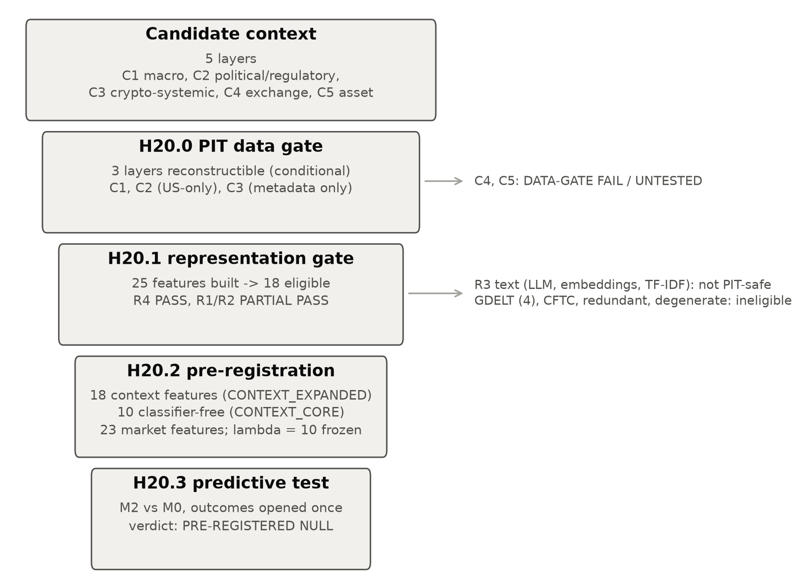
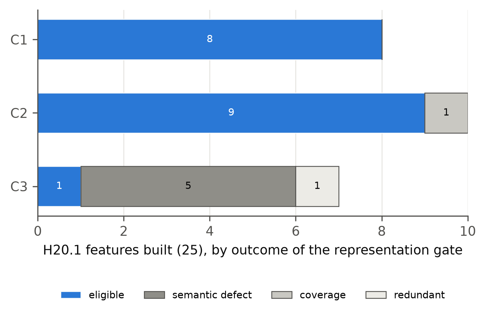
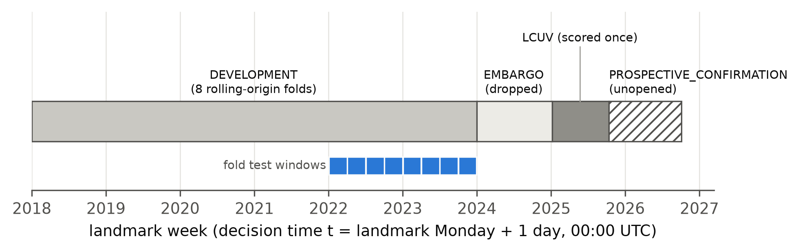
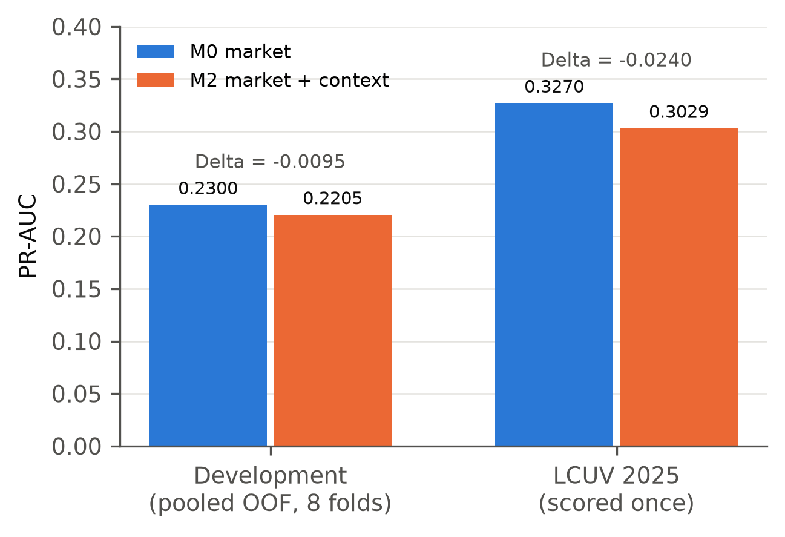
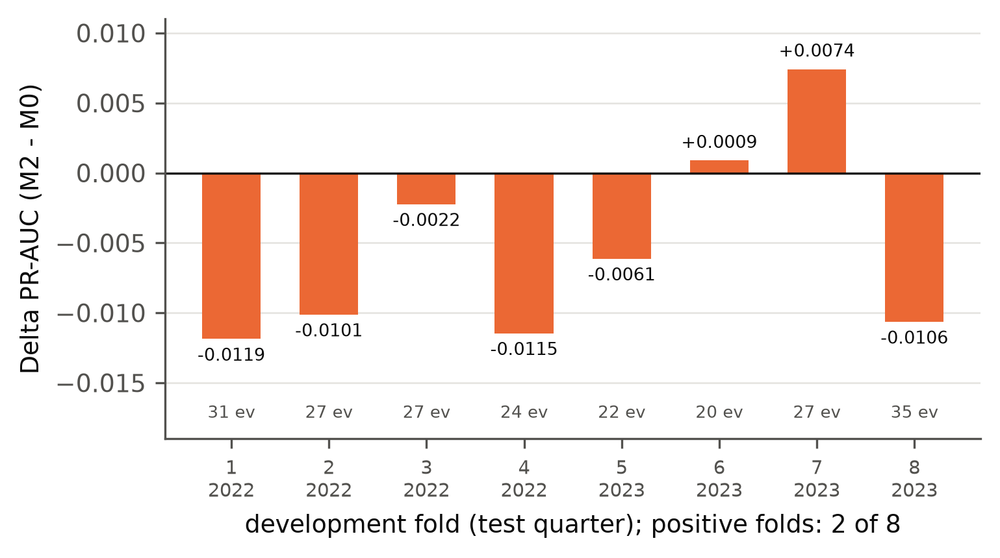
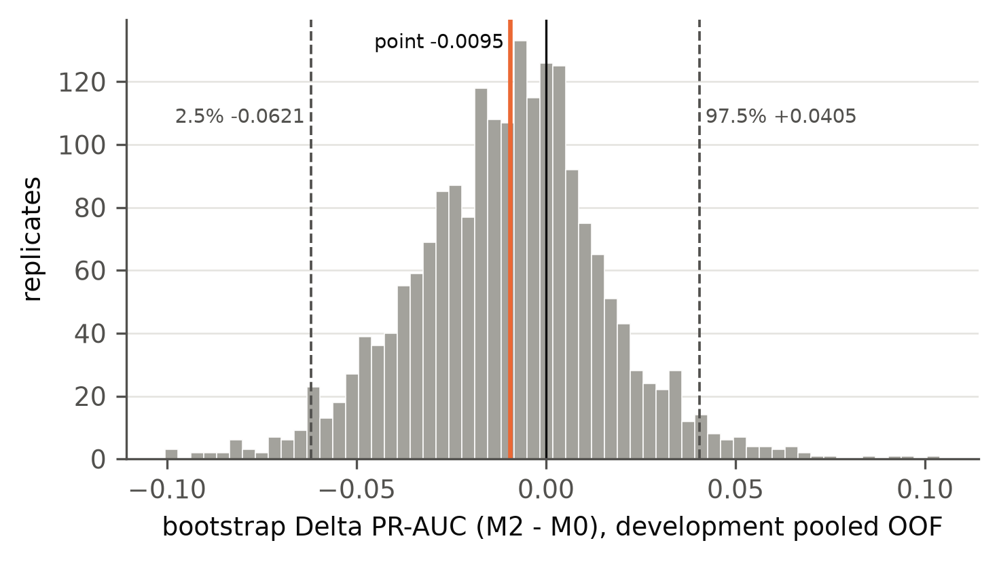

## Abstract

We examine the premise that news, regulatory and macroeconomic context known at decision time adds
predictive information to market data. Testing
that premise requires two conditions that are easy to violate. Context must be reconstructed as it
was available at each historical decision time, and it must be transformed into features without
importing later knowledge. We test the premise in a staged design that separates the two conditions from the
prediction question:

1. a data-feasibility gate asks which context layers can be reconstructed point-in-time (PIT);
2. a representation gate asks which reconstructed context can become deterministic, auditable,
   transform-time-PIT features;
3. a pre-registration freezes the predictive comparison before any outcome is opened;
4. the outcome is opened once.

The application is the prediction of Binance full-asset delisting announcements within 365 days. Of
five candidate context layers, three were reconstructible and only conditionally so: macro, US
political/regulatory, and a thin crypto-systemic layer. Exchange-specific and asset-specific
context failed the data gate. Of 25 representations built from the surviving substrate, 18 passed
the representation gate. No model-based text representation qualified as transform-time PIT. What
survived is US macro and regulatory calendars and values plus one crypto-attention count, all common
to every asset in a week, so the experiment tests whether that context predicts *when* delistings
cluster, not *which* asset is delisted. The evaluation period holds about two non-overlapping 365-day
label windows, and only large increments could have been detected.

In the frozen primary comparison (L2 logistic, λ = 10), adding the 18 context features to a
23-feature market baseline did not improve out-of-time precision–recall performance:
- **development:** pooled out-of-fold PR-AUC 0.2300 for the market baseline (M0) against 0.2205 with
  context (M2), ΔPR-AUC −0.0095. Two of eight folds were positive, and the two-way cluster-bootstrap
  95% interval was [−0.0621, +0.0405];
- **locked 2025 block** (not seen by any context model): 0.3270 against 0.3029, Δ −0.0240.

The development sign of Δ depends on the penalty: it is +0.0273 pooled under the strongest penalty
in the frozen exploratory grid. The locked-block Δ is negative under every specification reported.

The pre-registered verdict is **PRE-REGISTERED NULL**. Under the frozen point-in-time
specification, the surviving public-context feature set did not provide evidence of incremental
out-of-time predictive information about Binance full-asset delisting beyond the structured market
baseline. Both point estimates were negative, and the development interval included zero. The
result concerns that surviving representation, not public context in general.

## 1. Introduction

Market data are the default substrate of quantitative finance. A recurring proposal is that public
context, such as macroeconomic releases, regulatory actions and crypto-market news, adds information
that prices and volumes do not yet carry. Testing that proposal historically demands more than a
model comparison. A feature computed for a past date must use only what was public at that date, and
the procedure that turns documents into features must not use knowledge acquired later. Both
requirements can fail silently. A current web page about a past day may contain later revisions. A
missing source may be coded as “no event”. A text representation fitted on a corpus that includes
later years can encode the future in its parameters even when every input document is old.

This paper reports a full research cycle built to keep those failures out of a confirmatory test.
The cycle is staged so that each stage can fail without contaminating the next:

- **H20.0** asks whether context can be reconstructed point-in-time.
- **H20.1** asks whether the reconstructed substrate can be represented without future knowledge.
- **H20.2** freezes the predictive experiment before any outcome is opened.
- **H20.3** opens the outcome once and executes the frozen comparison.

The prediction task is deliberately concrete: whether a listed asset on Binance spot receives an
official full-asset delisting announcement within the next 365 days. That task has a validated event
universe and an established market baseline from prior work in the same repository. It also has a
plausible role for context: regulatory pressure, macro conditions and crypto-market stress could
precede venue decisions. Binance's current delisting FAQ lists legal/compliance, project
going-concern, market and ethical risk among the factors it considers [@binance_delisting_faq]. That
page is current documentation; it does not establish which criteria applied in each year of the
sample.

The answer is a pre-registered null for the context that survived the gates. We report it as a
result. We also report precisely what was *not* tested. The context layers arguably closest to the
outcome, exchange-specific and asset-specific information, failed the point-in-time data gate and never
entered the predictive experiment. That limitation is a finding of the feasibility stage, not an
omission.

**Relation to the companion paper.** This is the second paper from the research programme that
produced *Before the Backtest* [@ramossilva2026beforebacktest]. The two papers share their event
data and their discipline. Both use the same validated universe of 201 Binance full-asset delisting
events (stage H18.1b), and both fix their design before any outcome is opened. They differ in which
feasibility they check. This paper gates the data and the representation; *Before the Backtest* also
asks whether a design has enough statistical support to be run at all, a check this study did not run
(§7). They ask different questions. *Before the Backtest* asks whether a matched event study has enough
common support to be run at all, and stops one that does not. This paper asks whether point-in-time
public context adds predictive information to a market baseline. An earlier market-only test on the
same delisting target, H18.3, is listed in that paper's research registry, also as a pre-registered
null. This paper is a separate study: it does not revise the companion paper, and none of its
results is reported there.

## 2. Research question and contributions

**Question.** Does public context that was genuinely available at a historical decision time add
incremental out-of-time predictive information beyond structured market data? In this study the
question takes a narrower operational form. Every context feature that survived the gates is common
to all assets in a week, and in the linear primary model such a feature moves every asset's score in
that week by the same amount. The comparison can therefore gain only by ranking weeks against each
other, that is, by predicting *when* delisting announcements cluster, not *which* asset is delisted
(§7). The scientific object is the increment ΔPR-AUC = PR-AUC(M2) − PR-AUC(M0), not the absolute performance of either model.

**Contributions.** They are stated conservatively, and none is claimed as new (see §2.1):

1. **Two kinds of point-in-time validity.** We distinguish *document-time* PIT (the source record was
   public by *t*) from *transform-time* PIT (the transformation injects no knowledge unavailable at
   *t*). We operationalise the second as a classification of every candidate transform before use.
   The underlying risk, that a model trained on later text carries later knowledge into historical
   features, is established in the literature on look-ahead bias in language models
   [@glasserman2023lookahead; @kelly2026pit].
2. **A staged design** (source reconstruction → representation audit → pre-registration → outcome
   opening), with closed verdict lists, frozen bars and hash-chained freezes at each stage. It applies
   the principle that a design is fixed before outcomes are examined [@rubin2008design;
   @jbef_registered_reports].
3. **An empirical case study** in which additional public context, reconstructed strictly
   point-in-time, did not provide evidence of incremental out-of-time predictive value over a market
   baseline.
4. **A documentation of the small effective sample of shared context**, and of what it implies for
   power. Context that is identical for every asset in a week is informed by the number of distinct
   weeks and of non-overlapping label windows, not by the number of asset-week rows.

### 2.1 Related work

**Public context and crypto outcomes.** The evidence is mixed and mostly concerns returns, volume or
volatility over horizons of hours to days, not 365-day delisting:
- Regulatory news moves crypto prices, most strongly news about legal status, while unspecific
  official warnings had no measurable effect [@auer2018regulating]. That study measures
  contemporaneous market reactions, not prediction.
- Tweet counts predicted next-day trading volume and realised volatility, with weaker and mixed
  evidence for returns [@shen2019twitter].
- Twitter activity and sentiment predicted short-horizon altcoin returns in a short sample, for a
  selected subset of coins, with low out-of-sample fit [@steinert2018altcoin].
- The closest delisting study builds Binance delisting models whose predictors include news counts
  and topics and social-media metrics [@yang2026delistings]. Related distress and dead-coin
  prediction work uses market and activity variables [@bedowska2025zombie; @fantazzini2022creditrisk;
  @aldhahi2026regime].

**Look-ahead in text representations.** Language models trained on unrestricted corpora can embed
information from after a document's date. This look-ahead bias has been assessed for LLM sentiment
scores of news headlines [@glasserman2023lookahead]. It is the motivation for point-in-time language
models trained only on text available up to each date [@kelly2026pit]. Our transform-time
classification applies the same concern to every representation, including fitted statistics such
as TF-IDF, before any feature is used.

**Real-time information sets.** Using the data vintage available at the decision date, rather than
later revised data, is standard in real-time macroeconomics [@croushore1999realtime] and is what the
ALFRED archive supports [@alfred_help].

**Design discipline.** Fixing the design before outcomes [@rubin2008design;
@jbef_registered_reports] and accounting for selection across specifications [@bailey2014deflated]
inform the pre-registration, as does the evidence that independent analysts given the same data and
hypothesis disperse widely in their results [@menkveld2024nonstandard]. Survivorship and delisting bias
are documented in [@shumway1997delisting] and [@ammann2022survivorship]. Our previous paper applied an
outcome-free feasibility stop to a related delisting event set [@ramossilva2026beforebacktest].

## 3. Why historical context is hard to reconstruct

Four failure modes motivated the design. Each was measured in H20.0 or H20.1 rather than assumed.

- **Current version ≠ historical version.** Wikipedia's Current-Events day pages are a natural
  historical record, but they are edited after the fact. On the H20.0 sample, 13.5% of the items
  present on today's pages were absent at the decision time, and 96.4% of the pages were edited
  after it. Reading the revision current at *t* avoids this; reading today's page does not.
- **Missing ≠ zero.** A source that was not reachable is not a source that reported nothing. The CFTC
  press-release surface returned HTTP 429 for 2021–2026 in H20.0. Coding those years as “no CFTC
  release” would have manufactured a regulatory lull.
- **Coverage ≠ meaning.** A keyword tag can deliver high coverage and still not mean what its name
  says. The inherited GDELT crypto tag reached every sampled week, but only 0.679 of its positives
  were crypto articles when audited (H20.1).
- **Transform-time leakage.** A 2020 document embedded by a model trained on 2026 text is a 2020
  input passed through a 2026 function. Whether such a representation is a clean historical feature
  is a separate question from whether the document was public in 2020.

These distinctions are related to known concerns about leakage in machine-learning-based science
[@kapoor2023leakage] and selection effects in backtesting [@bailey2014deflated]. They are also related
to the principle that observational designs should be fixed before outcome data are examined
[@rubin2008design].

## 4. Point-in-time context framework

**Layers.** Context is organised by *who the information is about*:
- **C1 macro;**
- **C2 political/regulatory;**
- **C3 crypto-systemic;**
- **C4 exchange-specific;**
- **C5 asset-specific.**

**Times and admissibility.**
- Every record carries a public-availability time derived by fixed rules.
- Day-only documents are admitted from the next local midnight.
- Macro data vintages are admitted from the end of their vintage date in US Eastern time, so a model
  sees only the vintage available at *t* [@croushore1999realtime; @alfred_help].
- GDELT GKG records are produced in 15-minute update batches, with themes and tone assigned by
  GDELT's own processing [@gdelt_gkg_codebook_v21]. As our own conservative rule, a GDELT 15-minute
  file is admitted 15 minutes after its stamp.
- A Wikipedia page is read at the revision current at *t*.
- A record is admissible at *t* if and only if its availability time is ≤ *t*. Information at *t* +
  1 minute is future information.

**Document-time versus transform-time PIT.** Document-time PIT is a property of inputs. Transform-time
PIT is a property of the mapping from inputs to features, and has three classes:
- **PIT_SAFE:** deterministic rules whose parameters were fixed without reference to post-*t*
  documents. This covers counts, publisher categories, fixed dictionaries of generic terms, fixed
  arithmetic on as-of vintages, and attributes computed by a publisher at ingest time.
- **NON_PIT:** any model or statistic fitted on a corpus that includes post-*t* documents. For
  language models this is the look-ahead risk documented by [@glasserman2023lookahead] and
  [@kelly2026pit].
- **UNRESOLVED:** plausibly safe but not demonstrated.

Only PIT_SAFE features may enter a confirmatory design.

**Governance.**
- Every outbound request is logged and refused if it contains outcome vocabulary.
- Raw bytes are write-once.
- Every stage freezes its plan and rules before evaluation, records hashes, and logs every departure
  as a deviation.
- Verdicts come from closed lists. A criterion that could not be measured is not passed.

## 5. Context data feasibility (H20.0)

H20.0 asked whether a sufficiently complete, timestamped, reproducible point-in-time context corpus
could be reconstructed. It drew 35 quarterly decision timestamps (2018-Q1 to 2026-Q3) and registered
32 candidate sources, including rejected ones. It collected 141,751 documents for the sample windows,
and tested each layer against frozen bars:
- coverage;
- year span;
- timestamp quality;
- version quality, i.e. the share of documents whose content as of *t* is reconstructible (bar ≥ 0.70);
- refetch reproducibility;
- licensing;
- entity resolution for C4 and C5 (bar ≥ 0.80).

**Table 1. Context layers and H20.0 data-gate status**

| layer | G4 version share | G7 entity resolution | failed criteria | severe biases | H20.0 status |
|---|---|---|---|---|---|
| C1 Macro | 0.986 | n/a | none | archive_captured_le_t:S_FED_PRESS | CONDITIONAL (reconstructible) |
| C2 Political / regulatory | 0.875 | n/a | none | archive_captured_le_t:S_FED_PRESS | CONDITIONAL (reconstructible) |
| C3 Crypto-systemic | 1.0 | n/a | none | language_crypto_tag_rate; archive_captured_le_t:S_GDELT_GKG | CONDITIONAL (reconstructible) |
| C4 Exchange-specific | 0.385 | 0.795 | G4_version, G7_entity | archive_captured_le_t:S_BINANCE_CMS | DATA-GATE FAIL / UNTESTED |
| C5 Asset-specific | 0.398 | 0.581 | G4_version, G7_entity | archive_captured_le_t:S_BINANCE_CMS; entity_popularity_any_doc_w30 | DATA-GATE FAIL / UNTESTED |

**Verdict: PARTIAL PASS.**
- **C1 macro:** reconstructible, conditional on temporal and archive bias.
- **C2 political/regulatory:** reconstructible, conditional, and US-only.
- **C3 crypto-systemic:** reconstructible only in a limited form, as metadata and structured
  records, conditional on archive and language bias. The English crypto tag fired on 0.54% of English
  GDELT records against 0.14% of translingual records.
- **C4 exchange-specific:** failed. Binance notice text could be shown to read the same at *t* for
  only 0.385 of documents.
- **C5 asset-specific:** failed on version quality (0.398) and point-in-time naming (0.581).

Both C4 and C5 are **DATA-GATE FAIL / UNTESTED**, which is a statement about the data, not an
economic rejection.

## 6. Representation feasibility (H20.1)

H20.1 asked whether the C1–C3 substrate could become stable, reproducible, auditable features without
future knowledge. It froze its representation rules before drawing an independent evaluation sample
of 105 monthly decision timestamps (2018-01 to 2026-09). It then built 25 features in four families:
- **R1:** event flags;
- **R2:** counts and intensities;
- **R3:** text-derived representations;
- **R4:** as-of macro values.

**Transform-time audit.** Current LLM extraction, current sentence embeddings and TF-IDF fitted on the
full corpus were classified NON_PIT. TF-IDF refitted at each *t*, TF-IDF on a frozen pre-2018 corpus,
and pre-2018 static word embeddings were classified UNRESOLVED. None was built. The only R3 feature
built was a tone score computed by GDELT at ingest time. Point-in-time language models trained only
on earlier text [@kelly2026pit] are a possible future route for R3; none was evaluated here.

**Integrity.**
- 0 point-in-time violations over 55,561 provenance records;
- byte-identical deterministic rebuilds;
- complete provenance;
- missing values never encoded as zero.

**Semantic audit.** An independent sample of 272 documents was audited against a frozen bar of
precision ≥ 0.90. The labels were produced by the AI research agent, not by a human. That limitation
is disclosed throughout, and no classifier was retuned.
- The SEC, Federal Register, enforcement, FOMC and Wikipedia classifiers met the bar.
- The GDELT crypto tag did not: precision 0.679, mostly from articles that mention crypto only in
  passing.
- The crypto-stress dictionary had no positives at all in the evaluation windows.

**Table 2. Representation families and H20.1 eligibility**

| family | H20.1 verdict | built | eligible | ineligible (criterion) |
|---|---|---|---|---|
| R1 | PARTIAL PASS | 6 | 4 | F24: REDUNDANT with F23 (rho 0.9996); F25: semantic defect K5; SPARSE_DEGENERATE (nonzero share 0.0) |
| R2 | PARTIAL PASS | 15 | 11 | F17: coverage 0.314, 4 years; F19: semantic defect K6; F20: semantic defect K6; F21: semantic defect K6 |
| R3 | DATA-GATE FAIL / UNTESTED | 1 | 0 | F22: semantic defect K6 |
| R4 | PASS | 3 | 3 | none |

**Verdict: PARTIAL PASS.**
- **R4:** PASS.
- **R1, R2:** PARTIAL PASS.
- **R3:** DATA-GATE FAIL / UNTESTED.

The 18 eligible features are:
- 8 in C1 (Fed releases and FOMC statements; CPI and unemployment release flags; the as-of policy
  rate, CPI inflation and unemployment);
- 9 in C2 (Federal Register financial-regulator and crypto documents; SEC releases, enforcement
  and crypto releases; Fed enforcement; a crypto regulatory-action flag);
- 1 in C3.

The single C3 survivor is **generic English-Wikipedia crypto attention**: a count of crypto items on
the Current-Events pages. It is not a systemic-crypto-state variable.

## 7. Pre-registered predictive design (H20.2)

H20.2 froze the predictive experiment before any outcome was opened. It was hash-chained to the
H20.1 freeze and amended once (Addendum 02), before outcomes, as follows:
- it replaced the v1 primary rule, which selected λ from {0.1, 1, 10, 100, 1000} by mean fold PR-AUC,
  with a single a-priori λ = 10, and kept the v1 grid as an exploratory analysis;
- it renamed the 2025 block;
- it made the calibration criterion machine-readable.

The amendment was made before any outcome was opened. Its effect is known only now, and is reported
in §9 and Table 7. Under the v1 rule both M0 and M2 select λ = 1000, the development Δ is +0.0273 and
the LCUV Δ is −0.0167. S4 fails under either rule, so the verdict under the v1 rule would also have
been PRE-REGISTERED NULL.

**Unit and decision time.** The unit is an asset-era × weekly landmark. The asset-era follows the
inherited rule that a ticker starts a new era only after more than 365 days with no served route.
The decision time is **Tuesday 00:00 UTC after the landmark Monday**, so the landmark day's daily
candle is complete at *t*. The design is landmark-style: at each landmark, the risk set is the assets
still at risk, and predictors use only information available at the landmark, as in landmarking for
dynamic prediction [@putter2017landmarking]. We model a binary 365-day outcome with logistic
regression; no survival model is fitted.

**Target.** y = 1 if and only if the asset-era's validated full-asset delisting *announcement* falls
in (*t*, *t* + 365 days]. The announcement time comes from the frozen event universe and is never
the trading end. Landmarks whose announcement was already public at *t* are excluded from the risk
set.

**Features.**
- **M0 (23 market features):** liquidity, volatility and trailing return; route state (active pairs,
  quote assets); venue regime (listed assets, removal intensity, a calendar trend); and route
  history.
  - Inherited route-history features that rest on a class taken from Binance notice titles (C4) were
    excluded and replaced by notice-free versions, so the market baseline contains no venue-notice
    input.
  - Current listing status, whole-era quantities and every outcome column were excluded.
- **CONTEXT_EXPANDED:** the 18 H20.1-eligible features, computed at every landmark with the
  unchanged H20.1 rules.
- **CONTEXT_CORE:** the 10 features that use no agent-audited text classifier, fixed before any
  outcome as a robustness set.

**Arms.**
- **M0:** market only;
- **M2:** market + CONTEXT_EXPANDED;
- **M1:** context only;
- **M1_core, M2_core:** robustness arms.

The primary comparison is **M2 versus M0**.

**Model.** L2-penalised logistic regression with a single a-priori λ = 10, identical for every arm.
The objective is Σ log-loss + ½λ‖β‖² on standardised features. Preprocessing is identical for all
arms:
1. a fixed transform per feature;
2. winsorisation at the training 0.5th and 99.5th percentiles;
3. training-median imputation with missing indicators;
4. standardisation.

There is no class weighting and no recalibration. The λ grid and a LightGBM model were frozen as
*exploratory* only, unable to determine the verdict.

**Temporal design.**
- **Development:** landmarks 2018-01-01 to 2023-12-25, with eight rolling-origin folds
  [@hyndman2021fpp3]. Each fold has an expanding training window, a 365-day embargo and a quarterly
  test window in 2022–2023. The embargo follows from the label: a training landmark's 365-day
  outcome window must end before its fold's test window begins, so no delisting event can label both
  a training row and a test row.
- **Embargo:** a one-year embargo follows development.
- **LCUV:** a single locked block of landmarks 2025-01-06 to 2025-10-06, called the
  LOCKED_CONTEXT_UNSEEN_VALIDATION (LCUV) block.
  - No context or H20 model had seen it, and every rule was frozen before H20 scoring.
  - It is *not* an untouched holdout: the earlier H18.3 programme had observed market-only model
    behaviour in that period.
- **PROSPECTIVE_CONFIRMATION:** landmarks 2025-10-13 to 2026-09-28. It is the only block untouched by
  the programme and remains unopened until its outcomes mature.

**What the comparison can detect.** Context is common to every asset in a week. In the linear primary
model it cannot reorder assets within a week, so it can change a pooled PR-AUC only by ranking weeks,
which amounts to predicting the time variation of the 365-day delisting rate. The information for
that is small:
- the out-of-fold evaluation spans 104 weeks;
- each week's label looks 52 weeks ahead, so consecutive labels overlap almost entirely, and the
  evaluation period holds about two non-overlapping label windows.

The pre-registration recorded that low power made a null the likely outcome under modest effects. It
neither quantified the power nor set a stop rule, and no statistical-feasibility gate of the kind the
companion paper argues for was run. In our judgement such a gate, applied before the freeze, would
have flagged this comparison as underpowered and pointed the effort at the exchange- and
asset-specific layers, which are the ones that could reorder assets. A post-hoc yardstick is given in
§8.3.

**Metrics and inference.**
- **Primary:** PR-AUC (average precision), because the positive class is rare and ROC-based
  summaries can be misleading under heavy class imbalance [@saito2015precision].
- **Secondary:** ROC-AUC, Brier score, within-week top-decile lift and calibration.
- **Uncertainty:** a 2,000-replicate two-way bootstrap on the fixed out-of-fold predictions.
  - It adapts the pigeonhole bootstrap [@owen2007pigeonhole], which resamples the row entities and
    the column entities of a crossed design independently, with replacement. Here the rows are
    asset-eras and the columns are the eight fold test windows (quarterly calendar blocks), not
    individual weeks. Each landmark row is weighted by the product of its asset-era and block
    multiplicities, and the statistic is a weighted PR-AUC difference.
  - Owen's consistency results concern means, and Owen describes the procedure as mildly
    conservative there. For a rank-based statistic such as PR-AUC they are an approximation, not a
    guarantee.
  - Rows are clustered because observations of one asset and of one period are correlated, and
    ignoring that correlation biases conventional standard errors [@petersen2006standard].

**Promotion rule.** Support requires all of S1–S7:
- **S1:** positive development Δ;
- **S2:** at least five of eight positive folds;
- **S3:** a bootstrap lower bound above zero;
- **S4:** a positive LCUV Δ;
- **S5:** no severe calibration deterioration on the LCUV block;
- **S6:** a clean PIT audit;
- **S7:** a result not driven by one era: Δ > 0 in at least two of the three era blocks (the 2022
  folds, the 2023 folds and LCUV), and a development Δ that stays positive when each fold is left out
  in turn.

The closed verdict list is INCREMENTAL CONTEXT SIGNAL SUPPORTED, PRE-REGISTERED NULL, NEGATIVE
INCREMENTAL RESULT and DATA / DESIGN FAILURE.

## 8. Empirical results (H20.3)

### 8.1 Execution and audits

H20.3 followed the frozen P0–P6 sequence.

- **Context at every landmark** (353 decision times × 18 features):
  - zero records available after *t* and zero post-*t* joins;
  - complete provenance;
  - byte-identical deterministic rebuilds.
- **Route-state fallback.** The pre-registered structural trigger fired: window-based and
  candle-based route states disagreed on 4.554% of landmarks, above the frozen 1% bar. The frozen
  candle-based fallback was therefore applied. This was a structural rule computed before any
  outcome, not a post-result change.
- **X sealed before the outcome.** The feature matrix was sealed and hashed before the lifecycle
  table was opened.
- **Target.**
  - Strict timestamp parsing found no failures, and no event matched more than one asset-era.
  - The independently rebuilt target agreed with the inherited H18 label on all 93,394 matched rows.
- **Primary LCUV scoring** ran exactly once.

The PIT, target and execution audits all passed.

### 8.2 Effective sample

**Table 3. Temporal design and effective sample size**

| block | landmark Mondays | landmark rows | asset-eras | weeks | unique events | positive landmark rate |
|---|---|---|---|---|---|---|
| DEVELOPMENT | 2018-01-01 to 2023-12-25 | 78227 | 522 | 313 | 110 | 5.82% |
| EMBARGO (dropped) | 2024-01-01 to 2024-12-30 | not built |  | 53 |  |  |
| LCUV | 2025-01-06 to 2025-10-06 | 15167 | 443 | 40 | 86 | 11.79% |
| PROSPECTIVE_CONFIRMATION (unopened) | 2025-10-13 to 2026-09-28 | not built |  | 51 |  |  |

Positive landmark rows are not independent events. One delisting is the label of up to 52
consecutive weekly landmarks. Development contains 110 unique events, and the out-of-fold
evaluation spans 104 distinct weeks. Because context is common to every asset in a week, its
evidence rests on those weeks rather than on the 78,227 development rows.

### 8.3 Primary result

**Table 4. Development pooled out-of-fold results (L2 logistic, λ = 10)**

| arm | role | PR-AUC | ROC-AUC | Brier | top-decile lift (within-week) | within-week PR-AUC | calibration slope |
|---|---|---|---|---|---|---|---|
| M0 market | primary | 0.2300 | 0.767 | 0.0512 | 4.51 | 0.247 | 0.67 |
| M2 market + context | primary | 0.2205 | 0.750 | 0.0521 | 4.60 | 0.244 | 0.52 |
| M1 context only | secondary | 0.0674 | 0.540 | 0.0592 | 0.64 | 0.059 | 0.17 |
| M2_core market + CONTEXT_CORE | robustness | 0.2303 | 0.759 | 0.0522 | 4.61 | 0.245 | 0.58 |
| M1_core CONTEXT_CORE only | robustness | 0.0675 | 0.541 | 0.0573 | 0.64 | 0.059 | 0.20 |

**Table 5. LOCKED_CONTEXT_UNSEEN_VALIDATION (2025) results, scored once (L2 logistic, λ = 10)**

| arm | role | PR-AUC | ROC-AUC | Brier | top-decile lift (within-week) | within-week PR-AUC | calibration slope |
|---|---|---|---|---|---|---|---|
| M0 market | primary | 0.3270 | 0.809 | 0.0929 | 3.21 | 0.350 | 1.05 |
| M2 market + context | primary | 0.3029 | 0.806 | 0.0960 | 3.12 | 0.330 | 0.99 |
| M1 context only | secondary | 0.1193 | 0.506 | 0.1073 | 0.87 | 0.118 | 0.34 |
| M2_core market + CONTEXT_CORE | robustness | 0.3112 | 0.808 | 0.0972 | 3.10 | 0.337 | 1.01 |
| M1_core CONTEXT_CORE only | robustness | 0.1212 | 0.510 | 0.1091 | 0.87 | 0.118 | 1.25 |

**Development.**
- Pooled out-of-fold PR-AUC was 0.2300 for M0 and 0.2205 for M2: **ΔPR-AUC = −0.0095**, a relative
  change of −4.1%.
- Two of eight folds were positive.
- The two-way cluster-bootstrap 95% interval was [−0.0621, +0.0405].
- **Post-hoc yardstick (not pre-registered).** The interval's half-width implies a standard error of
  about 0.026. At that precision an increment would need to be about +0.07 PR-AUC, roughly 30% of
  M0's 0.2300, to be detected with 80% power at the 5% level. Smaller increments were unlikely to be
  detected.

**LCUV (scored once).** PR-AUC was 0.3270 for M0 and 0.3029 for M2: **ΔPR-AUC = −0.0240**, relative
−7.4%. An interval from a two-way bootstrap over asset-eras and calendar months (2,000 replicates)
was [−0.061, +0.001], with 3.05% of replicates positive. It is informational only: the
pre-registration assigned the confirmatory interval (S3) to development.

**Secondary metrics.** ROC-AUC and Brier score moved in the same direction as PR-AUC. Calibration on
the LCUV block did not deteriorate severely (Brier ratio 1.033 ≤ 1.05; slope excess −0.044 ≤ 0.20). In
development, M2's calibration slope was lower than M0's (0.52 against 0.67). S5 does not assess this,
because it is defined on LCUV; it is consistent with the added week-level features adding variance
under weak shrinkage (§9).

### 8.4 Verdict

**Table 6. Pre-registered criteria S1–S7 and the mechanical verdict**

| criterion | condition | observed | result |
|---|---|---|---|
| S1 | development pooled-OOF Δ > 0 | −0.0095 | FAIL |
| S2 | ≥ 5 of 8 folds with Δ > 0 | 2 of 8 | FAIL |
| S3 | two-way bootstrap 95% CI lower bound > 0 | [−0.0621, +0.0405] | FAIL |
| S4 | LCUV Δ > 0 | −0.0240 | FAIL |
| S5 | no severe calibration deterioration on LCUV (Brier ratio ≤ 1.05; slope excess ≤ 0.20) | Brier ratio 1.033; slope excess −0.044 | PASS |
| S6 | PIT audit passes | all stages PASS | PASS |
| S7 | Δ > 0 in ≥ 2 of 3 era blocks (2022 folds, 2023 folds, LCUV) and leave-one-fold-out Δ > 0 | 1 of 3 era blocks positive; min leave-one-fold-out Δ −0.0143 | FAIL |
| verdict | closed list, applied mechanically | PRE-REGISTERED NULL |  |

S5 and S6 passed. S1, S2, S3, S4 and S7 failed. No DATA / DESIGN FAILURE condition held: the PIT,
target, reproducibility and execution audits passed. The result is not a NEGATIVE INCREMENTAL
RESULT, because the development interval's upper bound (+0.0405) is above zero. The mechanical
verdict is **PRE-REGISTERED NULL**.

## 9. Robustness and exploratory results

**Table 7. Primary, robustness and exploratory results (only the primary determines the verdict)**

| analysis | status | development Δ, pooled OOF | development Δ, mean of folds | LCUV Δ | note |
|---|---|---|---|---|---|
| primary: logistic, λ = 10 (A02) | primary | −0.0095 | −0.0055 | −0.0240 | verdict: PRE-REGISTERED NULL |
| CONTEXT_CORE (classifier-free), λ = 10 | robustness | +0.0003 | −0.0039 | −0.0158 | two-way CI [−0.042, +0.045]; 3 of 8 folds positive |
| logistic, fold-selected λ (the v1 primary rule) | exploratory | +0.0273 | +0.0003 | −0.0167 | λ = 1000 selected for both M0 and M2; verdict under the v1 rule: PRE-REGISTERED NULL (S4 fails) |
| LightGBM, a-priori configuration | exploratory | +0.0285 | +0.0116 | −0.0080 | 7 leaves, 200 trees for every arm; M0 pooled PR-AUC 0.174 |
| LightGBM, fold-selected | exploratory | +0.0271 | +0.0107 | −0.0030 | selected: M0 15 leaves, 200 trees; M2 7 leaves, 200 trees |

**Classifier-free context (CONTEXT_CORE, secondary).** Replacing the expanded set with the 10
features that use no agent-audited classifier gave:
- a development Δ of +0.0003 pooled (−0.0039 as a mean of folds), with a two-way interval of
  [−0.042, +0.045];
- an LCUV Δ of −0.0158.

The null pattern persists in the classifier-free robustness specification. This shows that the
pattern is robust to removing those classifiers; it does not show that the classifiers had no
influence on the expanded-set result.

**Penalty path (read from the frozen exploratory run; no refit).**

**Table 8. Development Δ along the frozen λ grid (logistic; read from the frozen exploratory run, no refit; pooled values exist only for λ = 10 and the selected λ)**

| λ | M0 PR-AUC, mean of folds | M2 PR-AUC, mean of folds | Δ, mean of folds | Δ, pooled OOF |
|---|---|---|---|---|
| 0.1 | 0.2242 | 0.2195 | −0.0047 |  |
| 1 | 0.2246 | 0.2199 | −0.0048 |  |
| 10 (primary) | 0.2283 | 0.2228 | −0.0055 | −0.0095 |
| 100 | 0.2467 | 0.2411 | −0.0056 |  |
| 1000 | 0.2793 | 0.2796 | +0.0003 | +0.0273 |

The development Δ depends on the penalty:
- The primary λ = 10 is far from the baseline's own best. M0's mean-of-folds PR-AUC rises by about
  22% from λ = 10 to λ = 1000, the edge of the frozen grid, and the optimum may lie beyond it.
- Along the grid, the mean-of-folds Δ is negative up to λ = 100 and +0.0003 at λ = 1000.
- At λ = 1000 the pooled out-of-fold Δ is +0.0273, while the mean-of-folds Δ is +0.0003. A gain that
  appears only when the eight folds are pooled comes from aligning score levels across quarters, not
  from ranking within a quarter. That is the week-level channel described in §7.
- The LCUV Δ is negative at both penalties for which it was computed: −0.0240 at λ = 10 and −0.0167
  at λ = 1000.

The development sign of Δ is therefore not robust to the penalty, and the locked-block sign is
negative under every specification reported. The verdict does not depend on the penalty, because S4
fails under both the A02 rule and the v1 rule.

**Flexible models (exploratory; cannot change the verdict).** LightGBM behaves differently from the
logistic model. Its development gain is +0.0285 pooled and +0.0116 as a mean of folds, so part of it
is ranking within folds, which a nonlinear model can obtain by letting week-level context interact
with asset-level features. Two qualifications apply:
- The a-priori LightGBM baseline is weak. Its M0 reaches a pooled development PR-AUC of 0.174,
  against 0.2300 for the logistic M0, so the gain is measured from a lower starting point.
- The gain did not carry into the locked block: the LCUV Δ is −0.0080 for the a-priori
  configuration and −0.0030 for the fold-selected one.

Fold-selected configurations were chosen on the folds that score them, so their development values
carry selection optimism. The LightGBM selection also differs between arms (15 leaves for M0, 7 for
M2).

**Context-only arms.** Context-only models (M1, M1_core) showed little discrimination: development
ROC-AUC 0.540 and 0.541. This is consistent with context ranking weeks rather than assets.

## 10. Discussion

The study did not support the incremental-context hypothesis. The surviving representation, built
and audited as it was, did not improve out-of-time predictive performance for this target beyond
this baseline. The point estimates were negative, but the development interval included zero and is
wide enough that neither a negative nor a moderate positive increment is excluded. Several interpretations are
compatible with this finding. None is identified by the experiment, and they are offered as
hypotheses, not mechanisms.

1. **Redundancy.** Part of the public context may already be reflected in market variables such as
   liquidity, volatility and route structure, which respond to the same conditions.
2. **Target mismatch.** Macro and regulatory context can move market-wide risk without
   discriminating *which* asset will be fully delisted within a year.
3. **Cross-sectional limitation.** Context is identical for every asset at a given week, so in the
   linear primary model it can rank weeks but not assets (§7). The context-only arms' near-chance
   ROC-AUC is consistent with this.
4. **Horizon mismatch.** Short-lived public events may be weak predictors of an asset-specific
   decision up to 365 days later.
5. **Representation limitation.** The context most plausibly relevant to an asset's delisting,
   exchange-specific notices and asset-specific information, failed the point-in-time data gate and
   was never allowed into the confirmatory experiment. Stronger representations of those layers
   could behave differently.

The exploratory pattern is itself informative for practice. Tuned and more flexible models produced
pooled development gains of about +0.03 that reversed sign on the locked block; for the logistic
model the gain appeared only when folds were pooled (§9). In a study without a frozen
a-priori primary and a locked block, that pattern could have been reported as a context effect.

## 11. Limitations

- **Untested context.**
  - C4 and C5 failed the data gate and were not tested.
  - GDELT features failed the semantic audit.
  - No modern LLM, modern embedding or non-PIT text transform was used.
  - The C3 representation is thin: generic English-Wikipedia crypto attention.
- **Scope of the surviving context.** C2 is US-only. C1–C3 inherit H20.0's archive and language
  conditions.
- **Low power, quantified only post hoc.** The comparison ranks weeks (§7). The out-of-fold
  evaluation spans 104 weeks and the LCUV block 40, with 110 and 86 unique events, and the evaluation
  period holds about two non-overlapping 365-day label windows. Only increments of roughly +0.07
  PR-AUC would have been detected reliably (§8.3). No statistical-feasibility gate was run before the
  freeze.
- **Penalty dependence.** The development sign of Δ changes along the frozen λ grid (§9). The verdict
  does not.
- **Agent-produced semantic audit.** Eight of the 18 context features depend on classifiers audited
  by the AI research agent. The null pattern persists in the classifier-free robustness specification.
- **The LCUV block** is context-unseen, not programme-untouched. Prospective confirmation is pending.
- **Verifiability of the freeze order.** That each freeze preceded the outcome is attested by the
  author's own version history and by the hashes in the freeze files. No third-party timestamp, such
  as a registry deposit, exists for H20.0–H20.3.
- **Market substrate approximations.** Route state is reconstructed from daily candles; the frozen
  fallback addressed window gaps. Two events (IDRT, VAI) have no candles and two others (SKY, USDS)
  attach to no era under the inherited era rule; the rebuilt target agreed with the inherited label
  on every matched row.
- **Single venue and target.** Results concern Binance full-asset delisting announcements and do not
  extend to other venues, targets or horizons.

## 12. Implications for event-driven research

1. Separate document-time from transform-time point-in-time validity. Classify every transform before
   use; treat models trained on later corpora as non-PIT by default.
2. Gate context sources before modelling. Let a layer fail as “untested” rather than fill it with
   current versions or zeros.
3. Report the effective sample of shared context: distinct decision times and unique events, not
   asset-time rows.
4. Freeze an a-priori primary specification and a locked evaluation block; treat tuned gains as
   exploratory until they survive the block.
5. Report nulls with their scope. “This representation did not show incremental value here” is a
   result that a broader claim must not overwrite, and it is not evidence that no effect exists.

## 13. Conclusion

Under the frozen point-in-time specification, the surviving public-context feature set did not
provide evidence of incremental out-of-time predictive information about Binance full-asset delisting
beyond the structured market baseline. The pre-registered verdict is PRE-REGISTERED NULL. This is
an absence of evidence of incremental value, not evidence that context has no effect: the point
estimates were negative and the development interval included zero. The finding is bounded by what
survived the gates. Exchange-specific and asset-specific context could not be reconstructed
point-in-time here and remain untested. The comparison could detect only large increments, and its
development sign depends on the penalty. Prospective confirmation is pending.

## Use of AI tools

The research was carried out with an AI coding agent (Claude, Anthropic) working in the author's
repository. The agent wrote and ran the collection, feature, audit and model code for H20.0–H20.3,
produced the semantic-audit labels for the H20.1 classifiers (§6), drafted the pre-registration
documents and this manuscript, and ran the claim audit that checks every number in the text against
the frozen artefacts. The author set the research question and each stage's brief and constraints,
authorised each freeze and the single opening of the outcome, decided what to publish, and is
responsible for the content. No language model was used to construct any feature (§6).

## Data and code availability

The public package is the `contextual-alpha/` directory of the repository that also holds the
companion paper [@ramossilva2026beforebacktest]. It contains:
- the frozen plans, pre-registrations and freeze files with their SHA-256 hashes;
- the collection, build, audit and model scripts, and the tests;
- the evidence tables behind every number, the claim ledger and its audit.

A reader can verify from it that every frozen file matches its recorded hash, and that every number
in this paper matches its frozen source. A reader cannot verify from it:
- **the raw corpora**, which are not redistributed; the retrieval scripts document how to obtain them;
- **the inherited H18 inputs** (the event universe and the market bars), which belong to the
  research repository;
- **the order of events.** The freezes were committed in the author's research repository (H20.0
  `a14c347`, H20.1 `e21c264`, H20.2 with Addendum 02 `9932e20`, H20.3 `180def4`), whose history is
  not public.

The scripts document and audit the procedure; they do not run end to end from the public package
alone. Paper tables and figures are regenerated by `paper/scripts/build_paper_assets.py`.

## References

## Appendix A. Feature-level eligibility (H20.1)

**Table A1. H20.1 feature-level eligibility**

| feature_id | feature_name | layer | family | eligible_h20_2 | failed_criteria |
|---|---|---|---|---|---|
| F01 | c1_fed_release_count_W7 | C1 | R2 | True |  |
| F02 | c1_fed_monetary_policy_count_W30 | C1 | R2 | True |  |
| F03 | c1_fomc_statement_flag_W7 | C1 | R1 | True |  |
| F04 | c1_cpi_release_flag_W7 | C1 | R1 | True |  |
| F05 | c1_unrate_release_flag_W7 | C1 | R1 | True |  |
| F06 | c1_policy_rate_asof | C1 | R4 | True |  |
| F07 | c1_cpi_yoy_asof | C1 | R4 | True |  |
| F08 | c1_unrate_asof | C1 | R4 | True |  |
| F09 | c2_fedreg_finreg_doc_count_W7 | C2 | R2 | True |  |
| F10 | c2_fedreg_crypto_doc_count_W7 | C2 | R2 | True |  |
| F11 | c2_fedreg_crypto_doc_count_W30 | C2 | R2 | True |  |
| F12 | c2_fedreg_crypto_rulemaking_count_W30 | C2 | R2 | True |  |
| F13 | c2_sec_press_count_W7 | C2 | R2 | True |  |
| F14 | c2_sec_enforcement_count_W7 | C2 | R2 | True |  |
| F15 | c2_sec_crypto_press_count_W30 | C2 | R2 | True |  |
| F16 | c2_fed_enforcement_count_W30 | C2 | R2 | True |  |
| F17 | c2_cftc_press_count_W30 | C2 | R2 | False | coverage 0.314, 4 years |
| F18 | c2_crypto_regulatory_action_flag_W7 | C2 | R1 | True |  |
| F19 | c3_gdelt_crypto_record_count_S7 | C3 | R2 | False | semantic defect K6 |
| F20 | c3_gdelt_crypto_record_share_S7 | C3 | R2 | False | semantic defect K6 |
| F21 | c3_gdelt_crypto_record_share_en_S7 | C3 | R2 | False | semantic defect K6 |
| F22 | c3_gdelt_crypto_tone_mean_S7 | C3 | R3 | False | semantic defect K6 |
| F23 | c3_wiki_crypto_item_count_D7 | C3 | R2 | True |  |
| F24 | c3_wiki_crypto_item_flag_D7 | C3 | R1 | False | REDUNDANT with F23 (rho 0.9996) |
| F25 | c3_crypto_stress_flag_D7 | C3 | R1 | False | semantic defect K5; SPARSE_DEGENERATE (nonzero share 0.0) |

## Appendix B. Fold-level development results

**Table A2. Fold-level development results (primary model)**

| fold | test era | test events | test rows | PR-AUC M0 | PR-AUC M2 | Δ (M2 − M0) | Δ (M2_core − M0) |
|---|---|---|---|---|---|---|---|
| 1 | 2022 | 31 | 4575 | 0.3794 | 0.3675 | −0.0119 | +0.0003 |
| 2 | 2022 | 27 | 4778 | 0.3608 | 0.3507 | −0.0101 | −0.0134 |
| 3 | 2022 | 27 | 4830 | 0.2305 | 0.2283 | −0.0022 | −0.0048 |
| 4 | 2022 | 24 | 4792 | 0.1538 | 0.1423 | −0.0115 | −0.0124 |
| 5 | 2023 | 22 | 4713 | 0.2034 | 0.1973 | −0.0061 | −0.0050 |
| 6 | 2023 | 20 | 4666 | 0.1351 | 0.1359 | +0.0009 | +0.0057 |
| 7 | 2023 | 27 | 4707 | 0.1614 | 0.1689 | +0.0074 | +0.0064 |
| 8 | 2023 | 35 | 4711 | 0.2017 | 0.1911 | −0.0106 | −0.0082 |

## Appendix C. Data sources

These are data surfaces, not literature citations:
- the Federal Reserve press-release feed;
- the Federal Register API;
- SEC newsroom press-release listings;
- CFTC press-release listings (2018–2021 pages only);
- ALFRED real-time data vintages for CPIAUCSL, UNRATE and DFF [@alfred_help];
- the English Wikipedia Portal:Current events day pages, read at the revision current at *t*;
- GDELT 2.0 GKG 15-minute files (H20.1 only; no GDELT feature was eligible) [@gdelt_gkg_codebook_v21];
- Binance spot market data and the frozen H18.1b full-delisting event universe (outcome only).
