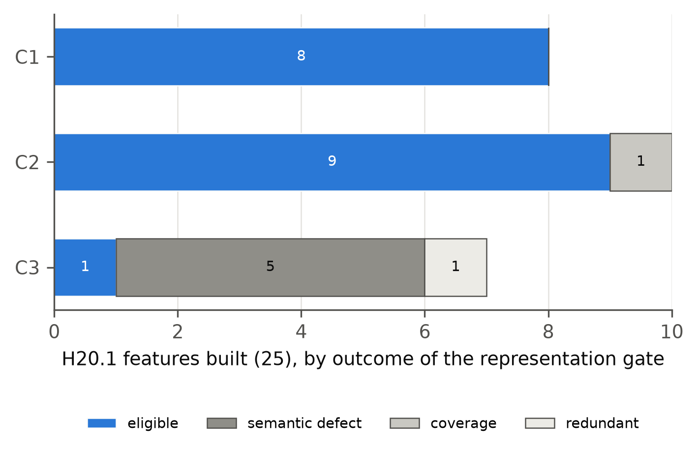
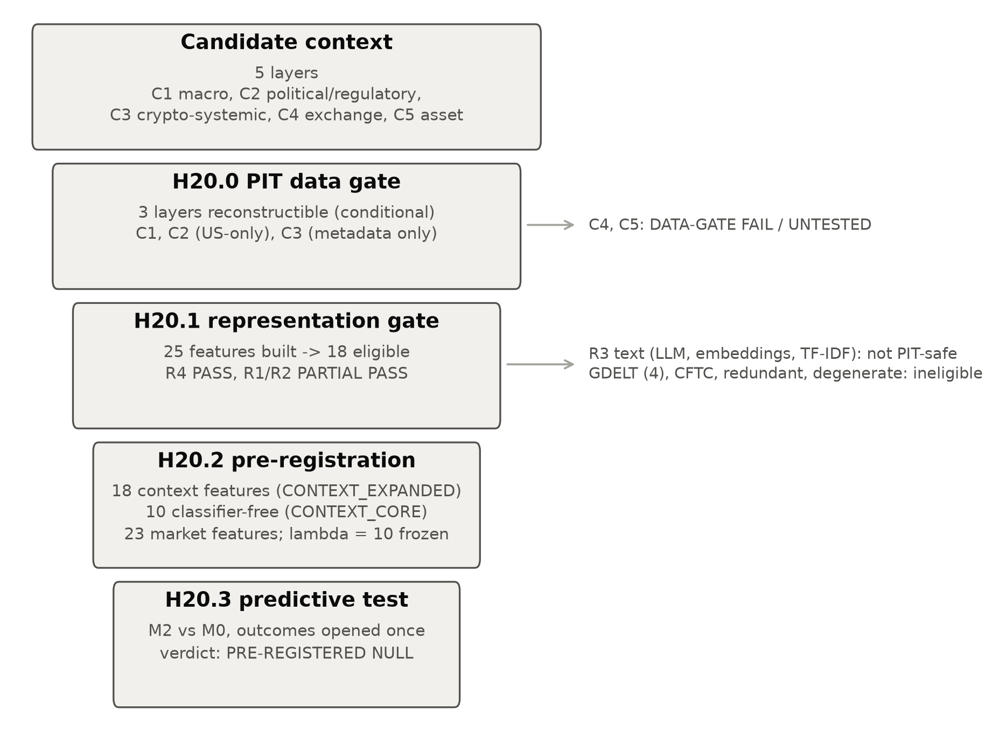
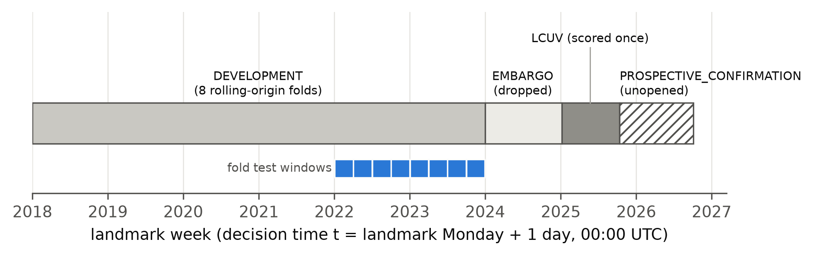
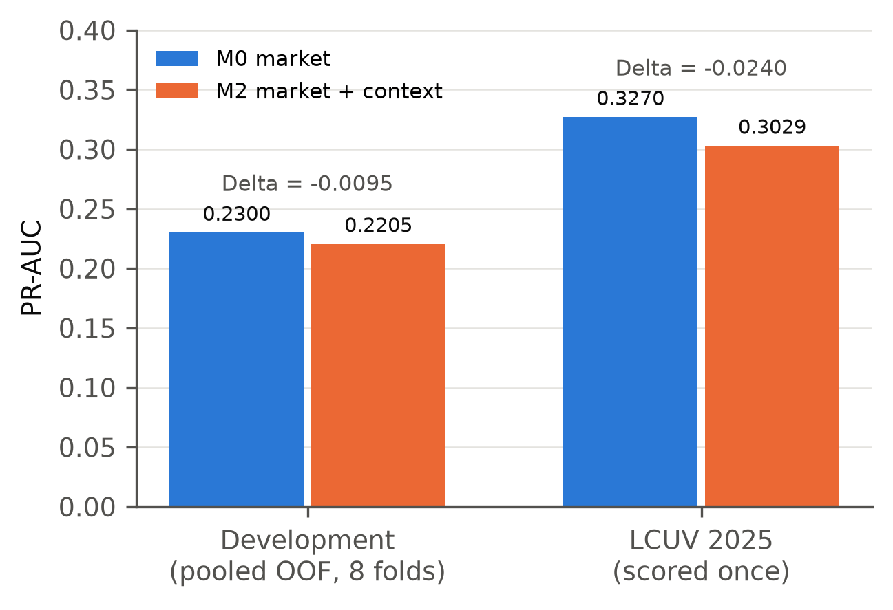
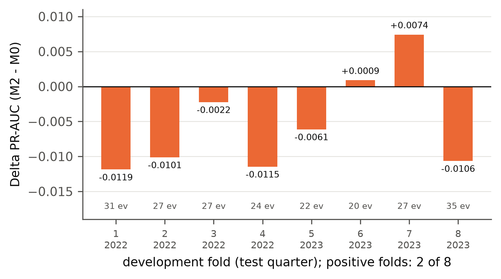
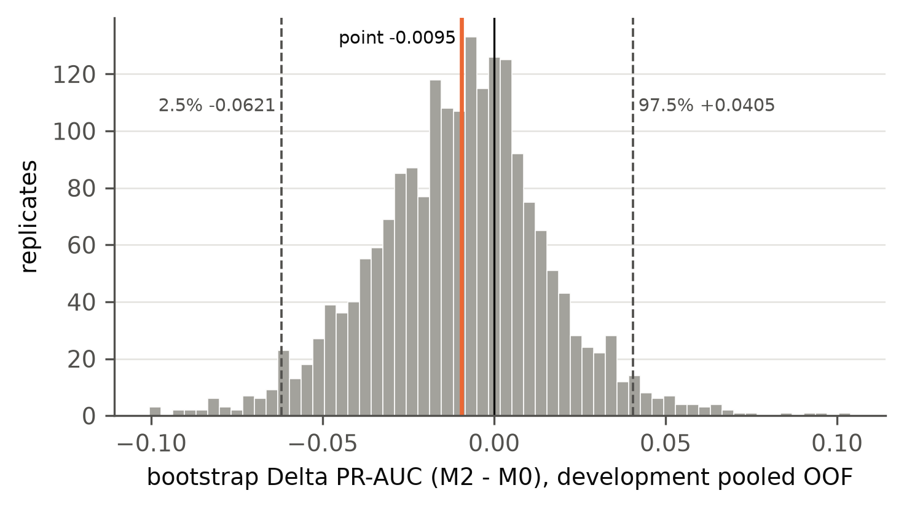

## Abstract

A common proposal in event-driven research is to add news, regulatory and macroeconomic context to
market data, on the premise that public information known at decision time is predictive. Testing
that premise requires two conditions that are easy to violate. Context must be reconstructed as it
was available at each historical decision time, and it must be transformed into features without
importing later knowledge. We test the premise in a staged design that separates the two conditions from the
prediction question:

1. a data-feasibility gate asks which context layers can be reconstructed point-in-time (PIT);
2. a representation gate asks which reconstructed context can become deterministic, auditable,
   transform-time-PIT features;
3. a pre-registration freezes the predictive comparison before any outcome is opened;
4. the outcome is opened once.

The application is the prediction of Binance full-asset delisting announcements within 365 days. Of
five candidate context layers, three were reconstructible and only conditionally so: macro, US
political/regulatory, and a thin crypto-systemic layer. Exchange-specific and asset-specific
context failed the data gate. Of 25 representations built from the surviving substrate, 18 passed
the representation gate. No model-based text representation qualified as transform-time PIT.

In the frozen primary comparison (L2 logistic, λ = 10), adding the 18 context features to a
23-feature market baseline did not improve out-of-time precision–recall performance:
- **development:** pooled out-of-fold PR-AUC 0.2300 for the market baseline (M0) against 0.2205 with
  context (M2), ΔPR-AUC −0.0095. Two of eight folds were positive, and the two-way cluster-bootstrap
  95% interval was [−0.0621, +0.0405];
- **locked 2025 block** (not seen by any context model): 0.3270 against 0.3029, Δ −0.0240.

The pre-registered verdict is **PRE-REGISTERED NULL**. Under the frozen point-in-time
specification, the surviving public-context feature set did not provide evidence of incremental
out-of-time predictive information about Binance full-asset delisting beyond the structured market
baseline. Both point estimates were negative, and the development interval included zero. The
result concerns that surviving representation, not public context in general.

## 1. Introduction

Market data are the default substrate of quantitative finance. A recurring proposal is that public
context, such as macroeconomic releases, regulatory actions and crypto-market news, adds information
that prices and volumes do not yet carry. Testing that proposal historically demands more than a
model comparison. A feature computed for a past date must use only what was public at that date, and
the procedure that turns documents into features must not use knowledge acquired later. Both
requirements can fail silently. A current web page about a past day may contain later revisions. A
missing source may be coded as "no event". A text representation fitted on a corpus that includes
later years can encode the future in its parameters even when every input document is old.

This paper reports a full research cycle built to keep those failures out of a confirmatory test.
The cycle is staged so that each stage can fail without contaminating the next:

- **H20.0** asks whether context can be reconstructed point-in-time.
- **H20.1** asks whether the reconstructed substrate can be represented without future knowledge.
- **H20.2** freezes the predictive experiment before any outcome is opened.
- **H20.3** opens the outcome once and executes the frozen comparison.

The prediction task is deliberately concrete: whether a listed asset on Binance spot receives an
official full-asset delisting announcement within the next 365 days. That task has a validated event
universe and an established market baseline from prior work in the same repository. It also has a
plausible role for context: regulatory pressure, macro conditions and crypto-market stress could
precede venue decisions. Binance's current delisting FAQ lists legal/compliance, project
going-concern, market and ethical risk among the factors it considers [@binance_delisting_faq]. That
page is current documentation; it does not establish which criteria applied in each year of the
sample.

The answer is a pre-registered null for the context that survived the gates. We report it as a
result. We also report precisely what was *not* tested. The context layers arguably closest to the
outcome, exchange-specific and asset-specific information, failed the point-in-time data gate and never
entered the predictive experiment. That limitation is a finding of the feasibility stage, not an
omission.

## 2. Research question and contributions

**Question.** Does public context that was genuinely available at a historical decision time add
incremental out-of-time predictive information beyond structured market data? The scientific object
is the increment ΔPR-AUC = PR-AUC(M2) − PR-AUC(M0), not the absolute performance of either model.

**Contributions.** They are stated conservatively, and none is claimed as new (see §2.1):

1. **Two kinds of point-in-time validity.** We distinguish *document-time* PIT (the source record was
   public by *t*) from *transform-time* PIT (the transformation injects no knowledge unavailable at
   *t*). We operationalise the second as a classification of every candidate transform before use.
   The underlying risk, that a model trained on later text carries later knowledge into historical
   features, is established in the literature on look-ahead bias in language models
   [@glasserman2023lookahead; @kelly2026pit].
2. **A staged design** (source reconstruction → representation audit → pre-registration → outcome
   opening), with closed verdict lists, frozen bars and hash-chained freezes at each stage. It applies
   the principle that a design is fixed before outcomes are examined [@rubin2008design;
   @jbef_registered_reports].
3. **An empirical case study** in which additional public context, reconstructed strictly
   point-in-time, did not provide evidence of incremental out-of-time predictive value over a market
   baseline.
4. **A documentation of the small effective sample of shared context.** Context that is identical
   for every asset in a week is informed by the number of distinct weeks, not by the number of
   asset-week rows.

### 2.1 Related work

**Public context and crypto outcomes.** The evidence is mixed and mostly concerns returns, volume or
volatility over horizons of hours to days, not 365-day delisting:
- Regulatory news moves crypto prices, most strongly news about legal status, while unspecific
  official warnings had no measurable effect [@auer2018regulating]. That study measures
  contemporaneous market reactions, not prediction.
- Tweet counts predicted next-day trading volume and realised volatility, with weaker and mixed
  evidence for returns [@shen2019twitter].
- Twitter activity and sentiment predicted short-horizon altcoin returns in a short sample, for a
  selected subset of coins, with low out-of-sample fit [@steinert2018altcoin].
- The closest delisting study builds Binance delisting models whose predictors include news counts
  and topics and social-media metrics [@yang2026delistings]. Related distress and dead-coin
  prediction work uses market and activity variables [@bedowska2025zombie; @fantazzini2022creditrisk;
  @aldhahi2026regime].

**Look-ahead in text representations.** Language models trained on unrestricted corpora can embed
information from after a document's date. This look-ahead bias has been assessed for LLM sentiment
scores of news headlines [@glasserman2023lookahead]. It is the motivation for point-in-time language
models trained only on text available up to each date [@kelly2026pit]. Our transform-time
classification applies the same concern to every representation, including fitted statistics such
as TF-IDF, before any feature is used.

**Real-time information sets.** Using the data vintage available at the decision date, rather than
later revised data, is standard in real-time macroeconomics [@croushore1999realtime] and is what the
ALFRED archive supports [@alfred_help].

**Design discipline.** Fixing the design before outcomes [@rubin2008design;
@jbef_registered_reports] and accounting for selection across specifications [@bailey2014deflated]
inform the pre-registration. Our previous paper applied an outcome-free feasibility stop to a related
delisting event set [@ramossilva2026beforebacktest].

## 3. Why historical context is hard to reconstruct

Four failure modes motivated the design. Each was measured in H20.0 or H20.1 rather than assumed.

- **Current version ≠ historical version.** Wikipedia's Current-Events day pages are a natural
  historical record, but they are edited after the fact. On the H20.0 sample, 13.5% of the items
  present on today's pages were absent at the decision time, and 96.4% of the pages were edited
  after it. Reading the revision current at *t* avoids this; reading today's page does not.
- **Missing ≠ zero.** A source that was not reachable is not a source that reported nothing. The CFTC
  press-release surface returned HTTP 429 for 2021–2026 in H20.0. Coding those years as "no CFTC
  release" would have manufactured a regulatory lull.
- **Coverage ≠ meaning.** A keyword tag can deliver high coverage and still not mean what its name
  says. The inherited GDELT crypto tag reached every sampled week, but only 0.679 of its positives
  were crypto articles when audited (H20.1).
- **Transform-time leakage.** A 2020 document embedded by a model trained on 2026 text is a 2020
  input passed through a 2026 function. Whether such a representation is a clean historical feature
  is a separate question from whether the document was public in 2020.

These distinctions are related to known concerns about leakage in machine-learning-based science
[@kapoor2023leakage] and selection effects in backtesting [@bailey2014deflated]. They are also related
to the principle that observational designs should be fixed before outcome data are examined
[@rubin2008design].

## 4. Point-in-time context framework

**Layers.** Context is organised by *who the information is about*:
- **C1 macro;**
- **C2 political/regulatory;**
- **C3 crypto-systemic;**
- **C4 exchange-specific;**
- **C5 asset-specific.**

**Times and admissibility.**
- Every record carries a public-availability time derived by fixed rules.
- Day-only documents are admitted from the next local midnight.
- Macro data vintages are admitted from the end of their vintage date in US Eastern time, so a model
  sees only the vintage available at *t* [@croushore1999realtime; @alfred_help].
- GDELT GKG records are produced in 15-minute update batches, with themes and tone assigned by
  GDELT's own processing [@gdelt_gkg_codebook_v21]. As our own conservative rule, a GDELT 15-minute
  file is admitted 15 minutes after its stamp.
- A Wikipedia page is read at the revision current at *t*.
- A record is admissible at *t* if and only if its availability time is ≤ *t*. Information at *t* +
  1 minute is future information.

**Document-time versus transform-time PIT.** Document-time PIT is a property of inputs. Transform-time
PIT is a property of the mapping from inputs to features, and has three classes:
- **PIT_SAFE:** deterministic rules whose parameters were fixed without reference to post-*t*
  documents. This covers counts, publisher categories, fixed dictionaries of generic terms, fixed
  arithmetic on as-of vintages, and attributes computed by a publisher at ingest time.
- **NON_PIT:** any model or statistic fitted on a corpus that includes post-*t* documents. For
  language models this is the look-ahead risk documented by [@glasserman2023lookahead] and
  [@kelly2026pit].
- **UNRESOLVED:** plausibly safe but not demonstrated.

Only PIT_SAFE features may enter a confirmatory design.

**Governance.**
- Every outbound request is logged and refused if it contains outcome vocabulary.
- Raw bytes are write-once.
- Every stage freezes its plan and rules before evaluation, records hashes, and logs every departure
  as a deviation.
- Verdicts come from closed lists. A criterion that could not be measured is not passed.

## 5. Context data feasibility (H20.0)

H20.0 asked whether a sufficiently complete, timestamped, reproducible point-in-time context corpus
could be reconstructed. It drew 35 quarterly decision timestamps (2018-Q1 to 2026-Q3) and registered
32 candidate sources, including rejected ones. It collected 141,751 documents for the sample windows,
and tested each layer against frozen bars:
- coverage;
- year span;
- timestamp quality;
- version quality, i.e. the share of documents whose content as of *t* is reconstructible (bar ≥ 0.70);
- refetch reproducibility;
- licensing;
- entity resolution for C4 and C5 (bar ≥ 0.80).

{{TABLE:table1_context_layers}}

**Verdict: PARTIAL PASS.**
- **C1 macro:** reconstructible, conditional on temporal and archive bias.
- **C2 political/regulatory:** reconstructible, conditional, and US-only.
- **C3 crypto-systemic:** reconstructible only in a limited form, as metadata and structured
  records, conditional on archive and language bias. The English crypto tag fired on 0.54% of English
  GDELT records against 0.14% of translingual records.
- **C4 exchange-specific:** failed. Binance notice text could be shown to read the same at *t* for
  only 0.385 of documents.
- **C5 asset-specific:** failed on version quality (0.398) and point-in-time naming (0.581).

Both C4 and C5 are **DATA-GATE FAIL / UNTESTED**, which is a statement about the data, not an
economic rejection.

## 6. Representation feasibility (H20.1)

H20.1 asked whether the C1–C3 substrate could become stable, reproducible, auditable features without
future knowledge. It froze its representation rules before drawing an independent evaluation sample
of 105 monthly decision timestamps (2018-01 to 2026-09). It then built 25 features in four families:
- **R1:** event flags;
- **R2:** counts and intensities;
- **R3:** text-derived representations;
- **R4:** as-of macro values.

**Transform-time audit.** Current LLM extraction, current sentence embeddings and TF-IDF fitted on the
full corpus were classified NON_PIT. TF-IDF refitted at each *t*, TF-IDF on a frozen pre-2018 corpus,
and pre-2018 static word embeddings were classified UNRESOLVED. None was built. The only R3 feature
built was a tone score computed by GDELT at ingest time. Point-in-time language models trained only
on earlier text [@kelly2026pit] are a possible future route for R3; none was evaluated here.

**Integrity.**
- 0 point-in-time violations over 55,561 provenance records;
- byte-identical deterministic rebuilds;
- complete provenance;
- missing values never encoded as zero.

**Semantic audit.** An independent sample of 272 documents was audited against a frozen bar of
precision ≥ 0.90. The labels were produced by the AI research agent, not by a human. That limitation
is disclosed throughout, and no classifier was retuned.
- The SEC, Federal Register, enforcement, FOMC and Wikipedia classifiers met the bar.
- The GDELT crypto tag did not: precision 0.679, mostly from articles that mention crypto only in
  passing.
- The crypto-stress dictionary had no positives at all in the evaluation windows.

{{TABLE:table2_representation_families}}

**Verdict: PARTIAL PASS.**
- **R4:** PASS.
- **R1, R2:** PARTIAL PASS.
- **R3:** DATA-GATE FAIL / UNTESTED.

The 18 eligible features are:
- 8 in C1 (Fed releases and FOMC statements; CPI and unemployment release flags; the as-of policy
  rate, CPI inflation and unemployment);
- 9 in C2 (Federal Register financial-regulator and crypto documents; SEC releases, enforcement
  and crypto releases; Fed enforcement; a crypto regulatory-action flag);
- 1 in C3.

The single C3 survivor is **generic English-Wikipedia crypto attention**: a count of crypto items on
the Current-Events pages. It is not a systemic-crypto-state variable.

## 7. Pre-registered predictive design (H20.2)

H20.2 froze the predictive experiment before any outcome was opened. It was hash-chained to the
H20.1 freeze and amended once (Addendum 02), before outcomes, as follows:
- it fixed the primary penalty a priori;
- it renamed the 2025 block;
- it made the calibration criterion machine-readable.

**Unit and decision time.** The unit is an asset-era × weekly landmark. The asset-era follows the
inherited rule that a ticker starts a new era only after more than 365 days with no served route.
The decision time is **Tuesday 00:00 UTC after the landmark Monday**, so the landmark day's daily
candle is complete at *t*. The design is landmark-style: at each landmark, the risk set is the assets
still at risk, and predictors use only information available at the landmark, as in landmarking for
dynamic prediction [@putter2017landmarking]. We model a binary 365-day outcome with logistic
regression; no survival model is fitted.

**Target.** y = 1 if and only if the asset-era's validated full-asset delisting *announcement* falls
in (*t*, *t* + 365 days]. The announcement time comes from the frozen event universe and is never
the trading end. Landmarks whose announcement was already public at *t* are excluded from the risk
set.

**Features.**
- **M0 (23 market features):** liquidity, volatility and trailing return; route state (active pairs,
  quote assets); venue regime (listed assets, removal intensity, a calendar trend); and route
  history.
  - Inherited route-history features that rest on a class taken from Binance notice titles (C4) were
    excluded and replaced by notice-free versions, so the market baseline contains no venue-notice
    input.
  - Current listing status, whole-era quantities and every outcome column were excluded.
- **CONTEXT_EXPANDED:** the 18 H20.1-eligible features, computed at every landmark with the
  unchanged H20.1 rules.
- **CONTEXT_CORE:** the 10 features that use no agent-audited text classifier, fixed before any
  outcome as a robustness set.

**Arms.**
- **M0:** market only;
- **M2:** market + CONTEXT_EXPANDED;
- **M1:** context only;
- **M1_core, M2_core:** robustness arms.

The primary comparison is **M2 versus M0**.

**Model.** L2-penalised logistic regression with a single a-priori λ = 10, identical for every arm.
The objective is Σ log-loss + ½λ‖β‖² on standardised features. Preprocessing is identical for all
arms:
1. a fixed transform per feature;
2. winsorisation at the training 0.5th and 99.5th percentiles;
3. training-median imputation with missing indicators;
4. standardisation.

There is no class weighting and no recalibration. The λ grid and a LightGBM model were frozen as
*exploratory* only, unable to determine the verdict.

**Temporal design.**
- **Development:** landmarks 2018-01-01 to 2023-12-25, with eight rolling-origin folds
  [@hyndman2021fpp3]. Each fold has an expanding training window, a 365-day embargo and a quarterly
  test window in 2022–2023. The embargo follows from the label: a training landmark's 365-day
  outcome window must end before its fold's test window begins, so no delisting event can label both
  a training row and a test row.
- **Embargo:** a one-year embargo follows development.
- **LCUV:** a single locked block of landmarks 2025-01-06 to 2025-10-06, called the
  LOCKED_CONTEXT_UNSEEN_VALIDATION (LCUV) block.
  - No context or H20 model had seen it, and every rule was frozen before H20 scoring.
  - It is *not* an untouched holdout: the earlier H18.3 programme had observed market-only model
    behaviour in that period.
- **PROSPECTIVE_CONFIRMATION:** landmarks 2025-10-13 to 2026-09-28. It is the only block untouched by
  the programme and remains unopened until its outcomes mature.

**Metrics and inference.**
- **Primary:** PR-AUC (average precision), because the positive class is rare and ROC-based
  summaries can be misleading under heavy class imbalance [@saito2015precision].
- **Secondary:** ROC-AUC, Brier score, within-week top-decile lift and calibration.
- **Uncertainty:** a 2,000-replicate two-way bootstrap on the fixed out-of-fold predictions.
  - It adapts the pigeonhole bootstrap [@owen2007pigeonhole], which resamples the row entities and
    the column entities of a crossed design independently, with replacement. Here the rows are
    asset-eras and the columns are the eight fold test windows (quarterly calendar blocks), not
    individual weeks. Each landmark row is weighted by the product of its asset-era and block
    multiplicities, and the statistic is a weighted PR-AUC difference.
  - Owen's consistency results concern means, and Owen describes the procedure as mildly
    conservative there. For a rank-based statistic such as PR-AUC they are an approximation, not a
    guarantee.
  - Rows are clustered because observations of one asset and of one period are correlated, and
    ignoring that correlation biases conventional standard errors [@petersen2006standard].

**Promotion rule.** Support requires all of S1–S7:
- **S1:** positive development Δ;
- **S2:** at least five of eight positive folds;
- **S3:** a bootstrap lower bound above zero;
- **S4:** a positive LCUV Δ;
- **S5:** no severe calibration deterioration;
- **S6:** a clean PIT audit;
- **S7:** a result not driven by one era.

The closed verdict list is INCREMENTAL CONTEXT SIGNAL SUPPORTED, PRE-REGISTERED NULL, NEGATIVE
INCREMENTAL RESULT and DATA / DESIGN FAILURE.

## 8. Empirical results (H20.3)

### 8.1 Execution and audits

H20.3 followed the frozen P0–P6 sequence.

- **Context at every landmark** (353 decision times × 18 features):
  - zero records available after *t* and zero post-*t* joins;
  - complete provenance;
  - byte-identical deterministic rebuilds.
- **Route-state fallback.** The pre-registered structural trigger fired: window-based and
  candle-based route states disagreed on 4.554% of landmarks, above the frozen 1% bar. The frozen
  candle-based fallback was therefore applied. This was a structural rule computed before any
  outcome, not a post-result change.
- **X sealed before the outcome.** The feature matrix was sealed and hashed before the lifecycle
  table was opened.
- **Target.**
  - Strict timestamp parsing found no failures, and no event matched more than one asset-era.
  - The independently rebuilt target agreed with the inherited H18 label on all 93,394 matched rows.
- **Primary LCUV scoring** ran exactly once.

The PIT, target and execution audits all passed.

### 8.2 Effective sample

{{TABLE:table3_design_effective_units}}

Positive landmark rows are not independent events. One delisting is the label of up to 52
consecutive weekly landmarks. Development contains 110 unique events, and the out-of-fold
evaluation spans 104 distinct weeks. Because context is common to every asset in a week, its
evidence rests on those weeks rather than on the 78,227 development rows.

### 8.3 Primary result

{{TABLE:table4_development_results}}

{{TABLE:table5_lcuv_results}}

**Development.**
- Pooled out-of-fold PR-AUC was 0.2300 for M0 and 0.2205 for M2: **ΔPR-AUC = −0.0095**, a relative
  change of −4.1%.
- Two of eight folds were positive.
- The two-way cluster-bootstrap 95% interval was [−0.0621, +0.0405].

**LCUV (scored once).** PR-AUC was 0.3270 for M0 and 0.3029 for M2: **ΔPR-AUC = −0.0240**, relative
−7.4%. The informational interval was [−0.061, +0.001].

**Secondary metrics.** ROC-AUC and Brier score moved in the same direction as PR-AUC. Calibration on
the LCUV block did not deteriorate severely (Brier ratio 1.033 ≤ 1.05; slope excess −0.044 ≤ 0.20).

### 8.4 Verdict

{{TABLE:table6_verdict}}

S5 and S6 passed. S1, S2, S3, S4 and S7 failed. No DATA / DESIGN FAILURE condition held: the PIT,
target, reproducibility and execution audits passed. The result is not a NEGATIVE INCREMENTAL
RESULT, because the development interval's upper bound (+0.0405) is above zero. The mechanical
verdict is **PRE-REGISTERED NULL**.

## 9. Robustness and exploratory results

{{TABLE:table7_robustness_exploratory}}

**Classifier-free context (CONTEXT_CORE, secondary).** Replacing the expanded set with the 10
features that use no agent-audited classifier gave:
- a development Δ of +0.0003, with a two-way interval of [−0.042, +0.045];
- an LCUV Δ of −0.0158.

The null pattern persists in the classifier-free robustness specification. This shows that the pattern is robust to removing those classifiers; it does not show that the classifiers had no influence on the expanded-set result.

**Exploratory tuning (labelled exploratory; cannot change the verdict).** More flexible or
fold-selected models showed apparent development gains that did not persist into the locked block:

| model | development Δ | LCUV Δ |
|---|---|---|
| logistic, fold-selected λ | +0.027 | −0.017 |
| LightGBM, a-priori configuration | +0.029 | −0.008 |
| LightGBM, fold-selected | +0.027 | −0.003 |

More flexible or selected specifications produced apparent development improvements that did not
persist in the locked context-unseen block. Each fold-selected configuration was chosen on the same
folds that score it, so the pattern is consistent with selection optimism, which the a-priori
primary penalty was frozen to avoid. It does not, by itself, identify overfitting.

**Context-only arms.** Context-only models (M1, M1_core) showed little discrimination: development
ROC-AUC 0.540 and 0.541. This is consistent with context ranking weeks rather than assets.

## 10. Discussion

The study did not support the incremental-context hypothesis. The surviving representation, built
and audited as it was, did not improve out-of-time predictive performance for this target beyond
this baseline. The point estimates were negative, but the development interval included zero and is
wide enough that neither a negative nor a moderate positive increment is excluded. Several interpretations are
compatible with this finding. None is identified by the experiment, and they are offered as
hypotheses, not mechanisms.

1. **Redundancy.** Part of the public context may already be reflected in market variables such as
   liquidity, volatility and route structure, which respond to the same conditions.
2. **Target mismatch.** Macro and regulatory context can move market-wide risk without
   discriminating *which* asset will be fully delisted within a year.
3. **Cross-sectional limitation.** Context is identical for every asset at a given week. In a linear
   model it adds the same shift to every asset's score in that week, so it cannot by itself reorder
   assets within a week. The context-only
   arms' near-chance ROC-AUC is consistent with this.
4. **Horizon mismatch.** Short-lived public events may be weak predictors of an asset-specific
   decision up to 365 days later.
5. **Representation limitation.** The context most plausibly relevant to an asset's delisting,
   exchange-specific notices and asset-specific information, failed the point-in-time data gate and
   was never allowed into the confirmatory experiment. Stronger representations of those layers
   could behave differently.

The exploratory pattern is itself informative for practice. Tuned and more flexible models produced
development gains of about +0.03 that reversed sign on the locked block. In a study without a frozen
a-priori primary and a locked block, that pattern could have been reported as a context effect.

## 11. Limitations

- **Untested context.**
  - C4 and C5 failed the data gate and were not tested.
  - GDELT features failed the semantic audit.
  - No modern LLM, modern embedding or non-PIT text transform was used.
  - The C3 representation is thin: generic English-Wikipedia crypto attention.
- **Scope of the surviving context.** C2 is US-only. C1–C3 inherit H20.0's archive and language
  conditions.
- **Low power for a week-level signal.** The out-of-fold evaluation spans 104 weeks and the LCUV block
  40, with 110 and 86 unique events. A modest true effect would be hard to detect.
- **Agent-produced semantic audit.** Eight of the 18 context features depend on classifiers audited
  by the AI research agent. The null pattern persists in the classifier-free robustness specification.
- **The LCUV block** is context-unseen, not programme-untouched. Prospective confirmation is pending.
- **Market substrate approximations.** Route state is reconstructed from daily candles; the frozen
  fallback addressed window gaps. Two events (IDRT, VAI) have no candles and two others (SKY, USDS)
  attach to no era under the inherited era rule; the rebuilt target agreed with the inherited label
  on every matched row.
- **Single venue and target.** Results concern Binance full-asset delisting announcements and do not
  extend to other venues, targets or horizons.

## 12. Implications for event-driven research

1. Separate document-time from transform-time point-in-time validity. Classify every transform before
   use; treat models trained on later corpora as non-PIT by default.
2. Gate context sources before modelling. Let a layer fail as "untested" rather than fill it with
   current versions or zeros.
3. Report the effective sample of shared context: distinct decision times and unique events, not
   asset-time rows.
4. Freeze an a-priori primary specification and a locked evaluation block; treat tuned gains as
   exploratory until they survive the block.
5. Report nulls with their scope. "This representation did not show incremental value here" is a
   result that a broader claim must not overwrite, and it is not evidence that no effect exists.

## 13. Conclusion

Under the frozen point-in-time specification, the surviving public-context feature set did not
provide evidence of incremental out-of-time predictive information about Binance full-asset delisting
beyond the structured market baseline. The pre-registered verdict is PRE-REGISTERED NULL. This is
an absence of evidence of incremental value, not evidence that context has no effect: the point
estimates were negative and the development interval included zero. The finding is bounded by what
survived the gates. Exchange-specific and asset-specific context could not be reconstructed
point-in-time here and remain untested. Prospective confirmation is pending.

## Data and code availability

All stages are reproducible from the Contextual Alpha project directory. It contains:
- frozen plans, pre-registrations and freeze files with SHA-256 hashes;
- collection, build, audit and model scripts;
- tests;
- the evidence tables behind every number.

Frozen commits: H20.0 `a14c347`, H20.1 `e21c264`, H20.2 with Addendum 02 `9932e20`, H20.3 `180def4`.
Raw source content is not redistributed. Paper tables and figures are regenerated by
`paper/scripts/build_paper_assets.py`.

## References

The reference list is `paper/references.bib`.
- Eleven entries are reused unchanged from the author's previous paper in the same repository, which
  is itself cited as [@ramossilva2026beforebacktest].
- Fourteen entries were added in a verification pass. Each was read at the level recorded in
  `paper/REFERENCE_VERIFICATION.md`.
- Remaining gaps are recorded in `paper/REFERENCE_GAPS.md`.

Related work on cryptocurrency delisting and distress prediction includes [@yang2026delistings],
[@bedowska2025zombie], [@fantazzini2022creditrisk] and [@aldhahi2026regime]. Survivorship and
delisting bias are covered in [@shumway1997delisting] and [@ammann2022survivorship]. Registered
reports and dispersion across analysts are covered in [@jbef_registered_reports] and
[@menkveld2024nonstandard].

## Appendix A. Feature-level eligibility (H20.1)

{{TABLE:tableA1_feature_eligibility}}

## Appendix B. Fold-level development results

{{TABLE:tableA2_fold_results}}

## Appendix C. Data sources

These are data surfaces, not literature citations:
- the Federal Reserve press-release feed;
- the Federal Register API;
- SEC newsroom press-release listings;
- CFTC press-release listings (2018–2021 pages only);
- ALFRED real-time data vintages for CPIAUCSL, UNRATE and DFF [@alfred_help];
- the English Wikipedia Portal:Current events day pages, read at the revision current at *t*;
- GDELT 2.0 GKG 15-minute files (H20.1 only; no GDELT feature was eligible) [@gdelt_gkg_codebook_v21];
- Binance spot market data and the frozen H18.1b full-delisting event universe (outcome only).
