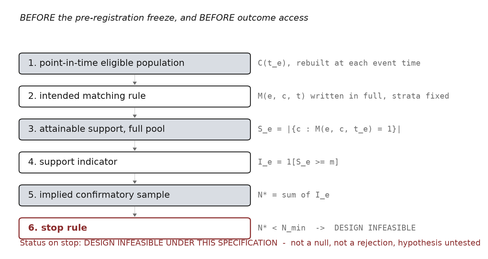
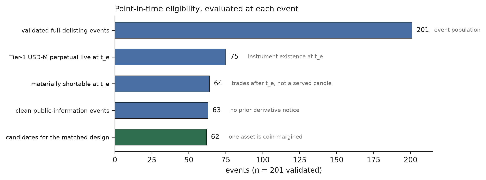
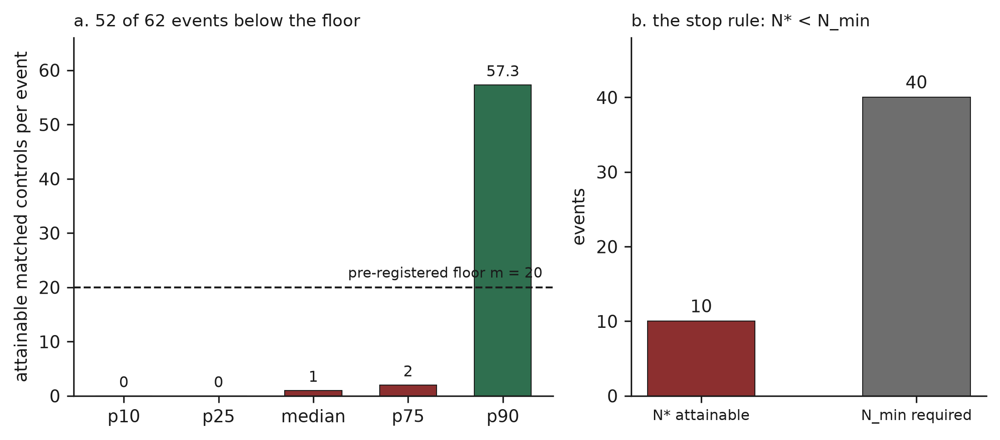
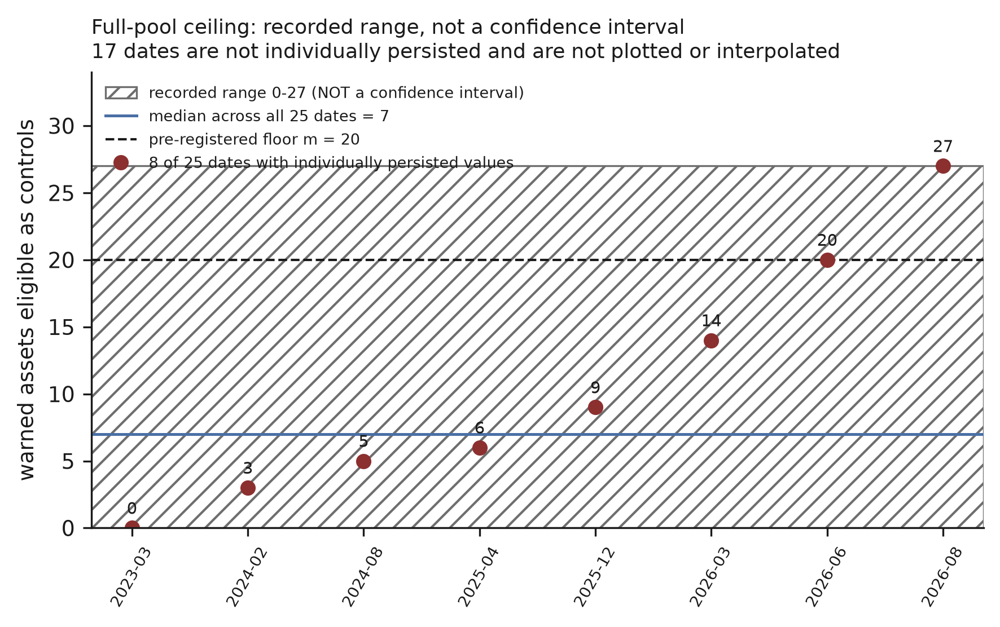

# Before the Backtest: Pre-Freeze Common-Support Ceilings for Event-Driven Strategy Research

**Working paper, V4.** 2026-10-12. Acceptance revision after referee report V3.

> **Relationship to earlier versions.** V1 (`paper.md`, SHA-256 `1853bce0…`), V2 (`paper_v2.md`,
> `b2c3ddae…`) and V3 (`paper_v3.md`, `5f5468eb…`) are frozen and are not edited. V4 applies the six
> editorial revisions required by `REFEREE_REPORT_V3.md`; it changes no result, no verdict and no
> claim of the science. Every V3→V4 edit is listed in `PAPER_V4_FREEZE.md`. **No experiment was run
> and nothing was recomputed.**

---

## Abstract

Matched event studies require that, for each event, a comparable control set exists. In
event-driven strategy research this requirement interacts with two constraints that are absent from
most applied settings: entity eligibility changes over time, so the control universe must be
reconstructed point-in-time, and the outcome — a price — is always already available to the
researcher, so nothing prevents the design from being adjusted after it is seen.

The design-stage principle is established: Rubin (2008) argues that observational studies must be
designed without examining outcome data, and that a candidate dataset may have to be rejected for
lack of covariate overlap. Overlap is normally diagnosed on the assembled analysis sample. We
describe and apply a narrower variant: a **pre-freeze common-support ceiling**, in which the maximum
attainable matched support is computed at each event time on the **complete point-in-time eligible
population**, before the design is frozen and before any outcome column is opened, and compared
against a pre-registered minimum. If the implied confirmatory sample falls below the minimum, the
study is `DESIGN INFEASIBLE UNDER THIS SPECIFICATION` and does not proceed.

We demonstrate it on 62 candidate cryptocurrency delisting events with an exact matching rule on
liquidity band and public-warning state and a floor of 20 matched controls. The realised distribution
of matched controls per event is p10 0, p25 0, median 1, p75 2, p90 57, with 52 of 62 events below
the floor. Computed on the complete eligible pool with no sampling, the per-date ceiling ranges from
0 to 27 warned assets with a median of 7, and only 3 of 25 announcement dates reach 20. The implied
confirmatory sample is 10 against a pre-registered minimum of 40, so the study stopped before freeze.
No price column was ever loaded: the data loader requested four non-price fields, which makes the
outcome-blindness of the decision checkable from source. Supporting material establishes that the
event population and the control universe can be reconstructed point-in-time at all.

**Keywords:** common support, positivity, outcome-free design, point-in-time data, event studies,
pre-registration, research feasibility.

---

## 1. Introduction

### 1.1 The question

Matched and controlled event designs rest on a condition that is easy to state and easy to assume:
for each treated event, the data must contain comparable untreated units. When that condition fails,
no estimator recovers the intended comparison; it either fails to run, or runs on an implicitly
redefined population.

This paper asks a narrow question:

> **Can an event-study design be shown to lack adequate common support before any outcome is
> opened?**

The answer we report is yes, for a particular class of designs, by a particular procedure, and at a
measurable cost.

### 1.2 What is already established

The principle that design precedes analysis is not new, and this paper does not claim it. Rubin
(2008) argues that observational studies must be designed **without examining any outcome data**,
and states explicitly that a candidate dataset may have to be rejected as inadequate for lack of
covariate data or lack of overlap between treated and control groups, revealed by propensity-score
analysis. That is the design-stage rejection this paper operationalises, and it is Rubin's.

Three further literatures bound what follows. Positivity — the requirement that every covariate
stratum occurring among the treated also occurs among controls — is formalised in causal inference,
with diagnostics and remedies including restricting the adjustment set, restricting the sample, or
modifying the target intervention (Petersen et al. 2012). Overlap diagnostics are implemented as
design-stage tools that are explicitly run before outcome data are used, for example in the design
module of the `PSweight` package, which visualises overlap and assesses balance prior to outcome
analysis; and the outcome-free two-stage design has been codified for regulatory submissions (Li
2023). Separately, the systematic-strategy literature establishes that reported performance must be
discounted for the number of specifications tried (Bailey & López de Prado 2014), that published
anomalies replicate poorly (Hou, Xue & Zhang 2020), and that analyst discretion alone produces
substantial dispersion on identical data (Menkveld et al. 2024).

### 1.3 The gap, stated cautiously

Overlap is normally diagnosed **on the assembled analysis sample**: the researcher builds the study,
then inspects whether the treated and control distributions overlap. Two features of event-driven
strategy research make that ordering insufficient.

First, **eligibility is time-varying**. Entities list, delist, change instrument coverage and change
regulatory state. The set of admissible controls at one event date is not the set at another, and
neither is the set available today. An overlap diagnostic run on whatever sample was assembled
cannot distinguish "the sample is small" from "the population could never have supplied a sample".

Second, **the outcome is always already available**. In a clinical or regulatory setting, outcome
blinding is partly enforced by data arriving later. In strategy research the price history sits in
the same archive as everything else, so blinding is procedural, and procedural blinding is exactly
what a reader cannot verify.

We therefore describe a variant with three specific properties: the support is computed on the
**complete point-in-time eligible population** rather than on an assembled sample; the result is
compared against a **pre-registered numeric minimum** that converts the diagnosis into a binding stop
rule rather than a judgement; and outcome-blindness is enforced **structurally**, at the data-access
layer, so it can be audited from source.

> **Novelty, bounded.** We are not aware of prior work that operationalises common-support
> feasibility in this exact pre-freeze, full-population, outcome-blind form, with a pre-registered
> numeric stop rule, for matched event studies in systematic strategy research. We do **not** claim
> that common support, positivity diagnostics, matching feasibility, outcome-free design or
> design-stage rejection are new. Each is established, and Rubin (2008) states the design-stage
> rejection directly.

### 1.4 Domain

The claims in this paper apply to: event-driven systematic research; event populations assembled
from public institutional documents and venue archives; free or public historical data; matched or
otherwise controlled event designs; and settings in which entity lifecycle and eligibility change
over time.

They are **not** claims about all quantitative research, all asset classes, all institutional desks,
or all systematic strategies. §7 reports the research registry that bounds them.

### 1.5 Contribution and roadmap

This paper makes one methodological contribution and reports one empirical demonstration of it.

The **contribution** is the pre-freeze common-support ceiling of §2: a procedure that takes a
proposed event set, a point-in-time control universe, an intended matching rule and a pre-registered
minimum, and returns a design-feasibility verdict before the outcome is opened. Its status as a
contribution rests on the combination set out in §2.6, not on any component.

The **demonstration** is §4: a design that looked well-resourced at 62 events with near-complete
data, and that the audit showed could never have been estimated under its own specification. The
verdict was reached with no price column loaded, which §2.5 makes checkable.

Everything else is support. §3 establishes that the inputs exist. §5 sets out what the gate prevents
and, equally, what it does not justify. §6 reports three results that bound the demonstration: that
the population is reconstructible at all, that point-in-time validity must extend to classification
logic, and that passing a feasibility gate does not substitute for out-of-sample falsification. §7
reports the full research registry, which shows that this paper's cases were selected after the fact
and does not support a broader thesis. §8 states the limitations, which are substantial.

### 1.6 Two definitions

**Point-in-time (PIT).** A quantity is point-in-time with respect to a decision at time *t* if it is
constructible from records whose publication or observation time precedes *t*. A value that is
numerically correct and correctly dated can still fail this test if the rule that assigned it used
information published after *t* (Supporting Case B).

**Common support.** Two groups have common support over a covariate set if every covariate stratum
occurring among the treated also contains comparison units. Under an exact matching rule it is a
counting condition: the matched cell must be non-empty at the required size. This is the
finite-sample form of positivity.

---

## 2. The design principle: pre-freeze feasibility

### 2.1 Point-in-time eligible universe

Let *E* be the proposed event set and *t_e* the time of event *e*. The candidate control universe
`C(t_e)` is constructed from information available by *t_e* only. Two rules do the work.

A current instrument or entity list may not be used as history. An entity that exists now need not
have existed at *t_e*, and an entity that existed then may have been removed since; in our setting
both directions occur. And an identifier is not an identity: where symbols can be reassigned, the
key is (entity, era), so a control is admitted only if the symbol belonged to the same entity at
*t_e*.

Eligibility is evaluated as of *t_e* and never afterwards. In particular, a control that is removed
**after** *t_e* remains a valid control at *t_e*; excluding it would use the future.

### 2.2 The proposed matching design

The matching rule `M(e, c, t)` is written in full before the ceiling is computed, including the
exact strata. In the demonstration it is exact matching on a liquidity band and on the entity's
public-warning state at *t_e*, with a minimum of *m* matched controls per event and a minimum
admissible confirmatory sample of *N_min* events.

The rule is the object under test. A different rule is a different design, with a different ceiling,
and the audit says nothing about it.

### 2.3 The full-pool support ceiling

> **PROCEDURE — PRE-FREEZE COMMON-SUPPORT AUDIT**
>
> **Input:** event set *E*; complete PIT candidate-control universe `C(t)`; matching function
> `M(e, c, t)`; minimum controls per event *m*; minimum admissible event count *N_min*.
>
> For each event *e* at time *t_e*:
> 1. construct `C(t_e)` from information available by *t_e*;
> 2. exclude controls ineligible under the PIT rules of §2.1;
> 3. apply the exact proposed matching rule;
> 4. compute the attainable support
>    **S_e = |{ c ∈ C(t_e) : M(e, c, t_e) = 1 }|**;
> 5. form the support indicator **I_e = 1[S_e ≥ m]**;
> 6. form the maximum confirmatory sample implied by the design
>    **N\* = Σ_e I_e**.
>
> **Decision.** If **N\* < N_min**, stop before outcome access.
>
> **Status:** `DESIGN INFEASIBLE UNDER THIS SPECIFICATION`.

Two properties distinguish `S_e` from a conventional overlap diagnostic.

**It is an upper bound, not an observation.** `S_e` is computed over the complete eligible pool
`C(t_e)`, so any realised matched set is a subset of the set it counts. If the researcher evaluates
only *k* candidates per event date, as is normal when each candidate requires a data fetch, the
realised count is at most `S_e` and typically below it. This matters for the decision the audit
supports: a low realised count is ambiguous between "we did not look hard enough" and "there is
nothing to find", and a low **ceiling** is not. When the ceiling is below the floor, no additional
sampling effort, no larger candidate draw and no further data collection can change the verdict, and
the researcher is spared the cycle of enlarging the search in the hope that the cell fills.

**It is per-event, not pooled.** A pooled overlap statistic averages over event dates and can be
dominated by a minority of well-supported events. In our demonstration the realised distribution is
bimodal, with a p90 of 57 and a median of 1: pooled, the design looks partially supported; per event,
most events have no comparison set at all. The quantity the design actually needs is the count of
events clearing the floor, which is why the audit aggregates to `N*` by counting indicators rather
than by averaging support.

**What the audit does not do.** It does not evaluate whether the matching covariates are the right
ones, whether unobserved confounding remains after matching, or whether the estimand is interesting.
It answers one question — can the specified comparison be formed — and a design that passes it can
still be badly identified for every other reason.

### 2.4 The freeze and stop rule

The audit is run **before** the pre-registration is frozen. This ordering is the point. If the ceiling
is computed after the freeze, a researcher facing an empty cell must either abandon a registered
design or amend it, and the amendment is made with knowledge of the scarcity. If it is computed
before, the design that gets frozen is one that could have been estimated, and the design that
cannot be is recorded as infeasible without ever having been registered.

*m* and *N_min* must be fixed before the audit, for the same reason: a floor chosen after seeing the
distribution of `S_e` is not a floor.

**The status is a statement about the design, not about the world.** `DESIGN INFEASIBLE UNDER THIS
SPECIFICATION` is not a null result, not a rejected hypothesis, and not evidence that the effect of
interest is absent. The hypothesis is untested. This distinction is not a technicality: a research
record that files infeasible designs as nulls will accumulate a literature of absences that were
never measured.

### 2.5 Structural outcome blinding

The credibility of the stop depends on knowing that no outcome informed it. Procedural blinding —
the researcher states that outcomes were not examined — cannot be checked by a reader.

We therefore enforce blinding at the data-access layer. The feasibility loader requests four fields:
open time, base volume, quote volume and trade count (`usecols=[0, 5, 7, 8]`). The OHLC columns never
enter memory. No return, VWAP, basis, funding direction or derivative-relative move can be computed
from what was read, by intent or by accident, and a reader can verify this by reading twenty lines of
the loader rather than by trusting a sentence.

When a design fails this audit, the failure is therefore an **outcome-blind design failure**: it is
known that no outcome could have influenced the decision, because no outcome was accessible to the
process that made it.

### 2.6 What this inherits, and what it adds

The components are not new and it is worth being exact about which part is which.

**Inherited: the design stage itself.** Rubin (2008) states the principle and the consequence
directly — observational studies are to be designed without examining outcome data, and a candidate
dataset may have to be rejected as inadequate for lack of overlap between treated and control
groups. A reader who takes only that from this paper has taken the main idea, and it is Rubin's. The
same applies to the outcome-free two-stage design as it has been codified for regulatory submissions
(Li 2023), and to design-stage overlap diagnostics implemented as tooling that runs before outcome
data are used.

**Inherited: the statistical object.** Common support is the finite-sample face of positivity, whose
diagnosis and remedies — restricting the adjustment set, restricting the sample, modifying the target
intervention — are established, as is the distinction between violations that are structural and
those that are artefacts of a finite sample (Petersen et al. 2012). Our §4 result is read against
that distinction rather than discovering it.

**Added, narrowly, and only in combination.** Three features of the variant described in §2.1–§2.5
are not, as far as we are aware, combined in prior work for this class of study.

1. **The support is computed on the complete point-in-time eligible population**, reconstructed
   separately at each event time, rather than on the sample the researcher has assembled. In settings
   with time-varying eligibility this is a different quantity: it separates "our sample is small"
   from "the population could not have supplied a sample", and only the second licenses a stop.
2. **The result is compared against a numeric minimum fixed before the audit**, which converts a
   diagnostic into a binding rule. Rubin's formulation — a dataset *may have to be* rejected — leaves
   the judgement with the analyst. Fixing *m* and *N_min* in advance removes the discretion at the
   moment it would otherwise be exercised, which is the moment the researcher discovers the cell is
   empty.
3. **Outcome-blindness is enforced structurally rather than procedurally**, at the data-access layer
   (§2.5). In settings where outcome data arrive later, blinding is partly enforced by time. In
   strategy research the price is in the same archive as the covariates, so the only verifiable
   blinding is one a reader can check in the code.

We state this as an absence of awareness rather than as priority. If the combination has been
formalised elsewhere, the contribution of this paper reduces to the empirical demonstration in §4,
which stands on its own.

---

## 3. Research setting and data construction

The demonstration requires four things to exist before the audit is meaningful: a validated event
population, a point-in-time instrument history, a point-in-time identity rule, and the matching
covariates. This section establishes them and nothing else; the construction work that produced them
is summarised in §6 and detailed in Appendix A.

**Setting.** Full-asset delistings announced by a single cryptocurrency venue, 2018-10-12 to
2026-09-24, with the corresponding perpetual futures contracts. The venue publishes both its
delisting notices and a historical archive of market data for instruments it has removed, which is
what makes a point-in-time reconstruction possible at all (§6.1).

**Event population.** 201 validated asset-level full-delisting events. The validation is described
in §6.1; recall against an independent, market-data-derived definition of cessation is 0.9801.

**Instrument history.** Terminated and current derivative contracts are equally observable in the
archive (1.0 and 1.0), with missingness differentials of 0.0 pp by year, liquidity bucket, timestamp
precision and notice order, so the PIT control universe of §2.1 can be built without a coverage
asymmetry between surviving and removed instruments.

**Identity.** Keys are (asset, era). An identity guard rejected one candidate mapping in which an
archive symbol belonged to an asset that had acquired the ticker four years after the event.

**Matching covariates.** The liquidity band is computed from the entity's own pre-event traded
notional. The public-warning state is the venue's published risk tag: 134 assets have ever carried
it, across 28 notices, and the tag universe was verified against six notice vocabularies.

**Why this setting is a fair test of the procedure, and where it is favourable.** It is favourable in
one respect: the venue publishes both its decisions and its historical market data, including for
instruments it has removed, so the point-in-time population of §2.1 is constructible at all. In most
settings it would not be, and the audit would be impossible rather than informative — which is itself
a finding about where the procedure can be applied (§6.1).

It is unfavourable, and therefore a fair test, in three respects. The event count is small by the
standards of equity event studies, so an infeasibility verdict is not surprising and the procedure
earns little credit for reaching it. The matching covariate that binds — the public warning — is a
rare state by construction, since a venue that warned most of its listings would not be warning
anyone. And the researcher had every incentive to find the design feasible: the question had no prior
empirical answer, the data quality was unusually good, and the alternative to proceeding was a null
result with nothing to report. The audit returned infeasible anyway, before any of that could be
weighed against an observed outcome.

---

## 4. Empirical demonstration

### 4.1 From event population to candidate design

| step | events | basis |
|---|---|---|
| validated full-delisting events | **201** | §3 |
| Tier-1 USDⓈ-M perpetual live at *t_e* | **75** | instrument existence at the event, not today |
| materially shortable at *t_e* | **64** | minutes with actual trading after *t_e*, not merely a served candle |
| clean public-information events | **63** | no prior derivative notice |
| candidates for the matched design | **62** | one asset's derivative is coin-margined, so a USDⓈ-M design returns nothing for it |

Sixty-two events, with near-complete data: spot 1-minute coverage 100%, perpetual 98.41%,
synchronised minutes in the primary window 98.41% with a median of 100%, and 62 of 63 events clearing
a pre-specified usability bar of 50. **By every data-quality measure the design looked
well-resourced.**

### 4.2 The intended matching rule

Each event is matched to controls in the same liquidity band **and** the same public-warning state at
*t_e*, requiring *m* = 20 matched controls per event, at least 73 valid 15-minute both-legs-traded
transitions per event, and *N_min* = 40 confirmatory events.

The warning-state stratum is not decorative, and the design does not survive dropping it. The
question is whether the derivative market moves ahead of the spot announcement in a way the spot
market does not. **52 of the 62 event assets carried the venue's public risk warning before the
announcement.** A comparison that does not hold the warning state fixed therefore contrasts
publicly-warned, visibly deteriorating assets against generic healthy ones, and any divergence it
measures is at least as plausibly the market's response to the public warning — information everyone
had — as it is an anticipation of the announcement. The stratum is what separates the hypothesis
from its leading rival.

The liquidity band plays a smaller but still necessary role: these are among the least liquid
instruments on the venue, and spot and derivative legs of illiquid pairs diverge mechanically when
arbitrage capacity is limited, independently of any information. Matching on liquidity does not
remove that channel, but it stops it from being confounded with the treatment.

### 4.3 The central result: realised support and the full-pool ceiling

**Realised support.** The distribution of matched controls per event is bimodal:

| p10 | p25 | median | p75 | p90 |
|---|---|---|---|---|
| 0 | 0 | **1** | 2 | 57 |

**52 of 62 events** fall below the floor of 20. Events whose asset was not warned find large pools;
events whose asset was warned find almost none — and 52 of the 62 event assets were warned.

**The ceiling.** Computed on the **complete** eligible pool with no sampling, the number of assets
simultaneously warned, still listed, not yet delisted, and carrying both a live perpetual and a live
spot route ranges from **0 to 27** across announcement dates, with a **median of 7**. Only **3 of 25
dates reach 20** — and that is before the liquidity band is matched at all.

The arithmetic behind the ceiling is simple and is the reason the result is structural rather than a
sampling artefact: the venue has warned **134 assets in total, ever**. At any given announcement
date, the subset simultaneously still listed, not yet delisted and carrying both instruments is
roughly seven. Requiring twenty of them, in the event's own liquidity band, cannot be satisfied by
collecting more data. Raising the per-date evaluation from 120 candidates to the full pool would move
the median matched cell from 1 to roughly 3, not to 20.

**Two checks confirm the constraint is the matching cell and not the pipeline.** Availability is not
binding: 2,857 of 2,877 evaluated non-event legs (99.3%) clear the availability bar. And the
transition filter never binds: zero events had at least 20 candidates of which fewer than 20 survived
it. The cell is empty before any downstream filter is reached.

### 4.4 The stop

Applying §2.3 with *m* = 20 and *N_min* = 40:

| quantity | value |
|---|---|
| candidate events | 62 |
| events meeting the support requirement, **N\*** | **10** |
| required minimum, *N_min* | **40** |
| implied development / holdout split | 9 / 1 |

A one-event holdout is not a holdout. **N\* = 10 < 40**, so the study stopped.

**The stop does not depend on the choice of floor.** The floor *m* = 20 is an engineering judgement
(§8), which invites the obvious objection that a lower floor would have rescued the design. It would
not, and this can be read off the already-reported quantiles without recomputing anything. The 75th
percentile of attainable support is **2**, so at most 25% of the 62 events — at most **15** events —
have more than two matched controls. Therefore for **any floor m ≥ 3**, the implied confirmatory
sample satisfies **N\* ≤ 15**, against *N_min* = 40. The 90th percentile is 57, so at most six
events have more than 57 controls, and N\* falls to roughly 6 at the top of the range.

In other words, the verdict is invariant across the entire range of floors from 3 upward: no
defensible choice of *m* produces a confirmatory sample of 40. The design fails not because the bar
was set high but because the distribution of attainable support is concentrated at zero and one.

**The same bound extends to the confirmatory minimum.** Because `N* ≤ 15` for every support floor
*m* ≥ 3, the infeasibility verdict also holds for **any admissible confirmatory minimum
*N_min* > 15**, not only for the pre-registered 40.

> **What this bound does and does not establish.** It is arithmetic on quantities already committed
> to the artefact — the reported support quantiles and the candidate count of 62 — and **it is not a
> sensitivity analysis**. Nothing was recomputed to obtain it. It establishes robustness to the
> choice of *m* for *m* ≥ 3, and to the choice of *N_min* for *N_min* > 15. It establishes **nothing**
> about: *N_min* ≤ 15; the matching rule; the definition of the liquidity band; the exactness or
> coarseness of matching; the covariate set; weighting; trimming; or redefinition of the estimand.
> Each of those is a different design (§8).

**Status: `DESIGN INFEASIBLE UNDER THIS SPECIFICATION`.** No pre-registration was frozen, no SHA-256
was computed for one, and the hypothesis was never tested. The absence of a frozen pre-registration
file for this study is itself the record that it stopped where it says it stopped.

> **The evidence here concerns detection, not specificity.** The procedure is demonstrated **once**,
> on **one specification**, which returned infeasible. This paper therefore provides evidence that
> the gate **can detect one infeasible design**. It does **not** estimate the gate's specificity, its
> false-positive rate, or the rate at which it would correctly allow a sound study to proceed.
>
> Concretely, there is **no case reported in this paper** in which (i) the same pre-freeze
> common-support audit returned *feasible*, (ii) the study then proceeded, and (iii) the resulting
> design was subsequently shown to be well identified. A gate is characterised by two error rates and
> we report evidence bearing on one of them. Nothing in the research registry of §7 supplies the
> other: those families were not evaluated by this procedure, and reading their outcomes as negative
> controls would be an inference the design does not support.

### 4.5 Outcome blindness

The loader requested open time, base volume, quote volume and trade count. **The OHLC columns never
entered memory.** No return, VWAP, abnormal score, basis or funding direction was computable from
what was read.

The decision in §4.4 is therefore an **outcome-blind design failure**. Two consequences follow. The
stop cannot have been motivated by an unattractive result, because no result existed. And any future
redesign of this question — weighting, trimming, coarsened matching, a redefined estimand — would be
a genuinely prospective study rather than a rescue, because no outcome has been seen at any point.

---

## 5. What the gate prevents

Absent a pre-outcome feasibility gate, a researcher meeting an empty matching cell has several moves
available, each defensible in isolation and each contaminated by the order in which it was taken.

They can **loosen the matching rule** — drop the warning stratum, widen the liquidity band — after
observing that the strict rule yields nothing, and in a setting where outcomes are already accessible
there is nothing to establish that the loosening was not informed by them. They can **switch
estimator**, from exact matching to weighting, after the counting rule fails. They can **extrapolate
by weighting** into strata with almost no comparison mass, which produces an estimate whose effective
population is defined by the overlap region rather than by the events of interest. They can **select
controls retrospectively**, keeping the cells that happen to be populated. Or they can **redefine the
estimand** after observing scarcity, and report the new one as though it had been the target.

With the gate, the inadequacy is a **pre-outcome fact**: the design could not have been estimated,
and that was established before anything was seen.

> **This is not a claim that the alternatives are invalid.** Weighting, overlap weights, trimming,
> coarsened matching and estimand redefinition are legitimate methods, and the positivity literature
> recommends several of them for practical violations. They answer **different estimands under
> different designs**. The objection is to reaching for them *after* a counting rule has failed, in a
> setting where the outcome was accessible throughout. Choosing one of them prospectively, with its
> own pre-registered feasibility audit, is a different and perfectly sound study.

We observe only that in this case the violation sits closer to the structural than the practical end
of the distinction drawn by Petersen et al. (2012) — a warned universe of 134 assets ever, and a
per-date median of 7 — and that the recommended response to a structural violation in that
literature is to redefine the estimand rather than to reach for a better estimator.

**Why the ordering is harder to verify here than in a clinical setting.** The objection above is not
that researchers are dishonest; it is that in this domain honesty is unverifiable by default. When
outcome data are collected after the design is fixed, the sequence is enforced by the calendar, and a
reader can check dates. When the outcome is a price series that has existed in the same archive as
every covariate since before the study was conceived, nothing about the data constrains the order of
operations. The researcher's own account of what they looked at and when is the only evidence, and it
is exactly the kind of evidence a sceptical reader should discount.

That asymmetry is the argument for §2.5. A loader that cannot read the outcome columns converts a
claim about the researcher's conduct into a property of the artefact. It is a small technical
measure, and it is the only part of this design whose honesty a reader can confirm without trusting
the author.

**A note on what the stop costs.** The gate is not free. It terminated a study on a question with no
prior empirical answer, on a sample with near-complete data, and it did so on the strength of a floor
nobody can defend from theory (§8). A research programme that applies this gate will stop studies
that a more permissive programme would have run, and some of those would have produced findings. The
claim here is only that the gate makes the trade-off explicit and places it before the outcome rather
than after it.

---

## 6. Supporting cases

Three results support the demonstration. They are evidence that the inputs to §2 exist, not separate
contributions.

### 6.1 Supporting Case A — the event population and control universe are reconstructible

A pre-freeze audit requires a point-in-time population, which requires that removed entities remain
observable. That is a property of who owns the record.

A three-venue probe of whether a venue serves historical data for instruments it has delisted
**failed** as a gate (4 of 9, 1 of 9 and 2 of 9 criteria; two of three venues were required). Inside
that failure is the measurement this paper depends on: one venue's retrieval differential between
active and delisted spot pairs is **0.0 pp**, with no candles served after the delisting instant, and
1,936 delisted symbols retaining history. The delisting-bias literature documents the opposite side
of this asymmetry — vendor databases from which removed entities are absent, with corrections
estimated at −55% for performance-related Nasdaq delistings and a size effect that does not survive
them (Shumway 1997; Shumway & Warther 1999), and an attribution in cryptocurrency to aggregators that
retain history only for currently listed assets (Ammann et al. 2022).

The event population itself required validation, not merely assembly. Of 1,422 pair-removal events,
only 102 — **7.2%** — are an asset leaving the spot market entirely; the rest are minor pair removals,
quote migrations, fiat pair removals and partial delistings. The validated universe of 201 events was
then checked against a denominator built from market data rather than from the documents being
validated: of 257 assets whose candles stopped being served, 197 carry an announcement and the
remaining 60 are individually classified, leaving **4 true false negatives** and recall **0.9801**. A
gold set of 100 events, 40 double-reviewed, returned all-field accuracy of 1.0 and reviewer churn of
0.0; the audit records that several first-pass fields are partly self-confirming and that the
independent evidence is the second-pass re-fetch and the rebuilt route state. Two diagnostics sit
below their 0.99 bar, at 0.9851 and 0.9847, and are named: three events traded materially for three
days past the cessation instant the venue's own notices state.

### 6.2 Supporting Case B — point-in-time must cover classification, not only values

The PIT rules of §2.1 govern values and dates. They are insufficient.

The removal classifications inherited into one family were numerically correct and correctly dated,
and were nonetheless not point-in-time: the **rule that assigned the class** used information
published after the decision. Re-deriving every label under a strictly backward-only window changed
**676 of 2,352 classes (28.7%)**, and one sub-class was far worse — 314 of 390 quote-retirement
labels, with a median lag of 49 days. An audit that checks values and dates would have found nothing.

**This is not a new leakage category.** Kapoor and Narayanan's (2023) taxonomy already contains
"model uses features which are not legitimate", and a feature whose classification used post-decision
information is plausibly an instance of it. What is reported here is a detection procedure applied to
a known class, and the rate it measured.

### 6.3 Supporting Case C — passing feasibility does not substitute for out-of-sample falsification

A feasibility gate establishes that a design *can* be estimated. It says nothing about whether the
estimate will survive.

One family in this program passed its feasibility and data gates, was pre-registered, hashed and
committed before execution, and was then executed. Development was positive in **8 of 8**
rolling-origin folds, with a pooled ΔPR-AUC of **+0.0270** (**+13.46%** relative) over 37,782
landmarks and 440 asset-eras, improving top-decile lift from 3.9909 to 4.7899 and improving the Brier
score. Its cluster-bootstrap 95% interval over asset-eras was **[−0.0074, +0.0628]**, which includes
zero, and its single-use holdout **reversed sign at −0.00753**.

**Verdict: `PRE-REGISTERED NULL`** — meaning the pre-registered support criteria were not met.

> **What that label does not mean.** It does not mean no effect exists. The interval is consistent
> with zero and equally consistent with a positive effect roughly twice the point estimate. Absence of
> effect is not demonstrated at this sample size.

The development and holdout blocks also differ materially in base rate, so the sign reversal cannot
be attributed uniquely to a changing effect; the frozen design does not decompose baseline-hazard,
feature-distribution and effect non-stationarity. The detail is in Appendix F.

---

## 7. Research denominator and scope

The cases in this paper were selected after the fact. The registry that makes that selection visible
is reported in full in Appendix B; the essentials belong here.

> **The four detailed cases were selected retrospectively for methodological informativeness.
> Hypothesis selection within families and case selection for this manuscript are different
> processes.** Hypothesis selection was pre-registered and, from the family in §6.3 onward, is
> auditable by hash and commit order. Case selection for this paper was not.

The registry contains **31 entries** across ten research cycles. Their terminal states:

| terminal state | entries |
|---|---|
| economic reject, with an economic quantity computed | **9** |
| data-gate fail / untested | 5 |
| construction or substrate pass (not hypotheses) | 3 |
| watch / research, inconclusive | 3 |
| infrastructure blocked | 2 |
| hypothesis selection (not a verdict) | 2 |
| **promoted** | **1** |
| implementation reject, economics unresolved | 1 |
| pre-registered null | 1 |
| identification blocked | 1 |
| execution / capacity screen fail | 1 |
| open | 1 |
| falsification of alternatives | 1 |

**The denominator does not support a broad thesis, and we do not advance one.** In nine entries an
economic quantity was computed and the verdict came from it; upstream construction or feasibility was
not the typical binding constraint across the whole program. The one promoted family was
subsequently archived as a defensive candidate for falling below a revised return hurdle, so the
process has not yet promoted anything that survived.

The bounded statement the registry does support is domain-specific: **in the subset of this program
concerned with event research assembled from public institutional documents and venue archives —
cycles 5 through 10 — upstream feasibility repeatedly became the binding constraint**, with five
data-gate failures, two infrastructure blocks, one identification block and one capacity screen
against one completed economic test. Whether that reflects the domain, the tightening of the
protocol over time, or both, this registry cannot separate, and we do not assert a cause.

Two readings compete and the data here cannot choose between them. On the first, the **domain**
changed: the early cycles studied liquid instruments where data is cheap and the open question is
economic, while the later cycles studied regulatory filings and venue archives where assembling a
valid population is the hard part. On the second, the **protocol** tightened: later families faced
more gates, so more of them died at gates, and the pattern partly measures the author's own
increasing strictness rather than the domains. Both are consistent with the registry, and §2's
governance history shows the protocol did in fact grow across exactly these cycles.

This is why the paper's claim is a claim about a **procedure**, not about a prevalence. We do not
argue that upstream feasibility is usually the binding constraint in quantitative research; the
registry refutes that. We argue that when it *is* the binding constraint, it can be detected before
the outcome is opened, and we demonstrate one case where it was.

---

## 8. Limitations

**One demonstration; specificity unmeasured.** The procedure is demonstrated once, on one
specification that returned infeasible (§4.4). The paper provides no case in which the audit returned
feasible and the resulting study was later shown to be well identified, so the gate's false-positive
behaviour is unmeasured and the registry in §7 cannot supply it.

**The matching rule is the largest unmeasured sensitivity.** Ranking what remains unresolved: the
floor-invariance bound of §4.4 settles sensitivity to *m* (for *m* ≥ 3) and to *N_min* (for
*N_min* > 15) using committed quantities. **After that bound, the largest remaining unmeasured design
sensitivity is the matching rule itself.** The ceiling depends on the exact warning-state match, on
the definition of the liquidity band, on the exactness or coarseness of the matching, and on the
chosen covariate set. A coarser stratification — warning state within a two-category liquidity split
rather than a finer band — could yield a materially different ceiling, and this paper does not measure
it.

> Consequently the paper establishes `DESIGN INFEASIBLE UNDER THIS SPECIFICATION`. It does **not**
> establish that this question cannot be identified. That distinction is carried deliberately in
> every place the verdict appears.

**The floor of 20 is an engineering judgement.** No theory supplies it. It was fixed before the audit,
which protects the sequence, not the value; a floor of 10 would have admitted more events. The same
applies to *N_min* = 40 and to the 73-transition requirement. **Threshold sensitivity is unmeasured**:
quantifying it requires re-running the audit across a grid of alternative bars, which was not done.

**The ceiling is endogenous to the venue's own policy.** The binding quantity in §4.3 is the size of
the warned universe — 134 assets, ever. That number is a consequence of how aggressively this venue
applies its risk tag, which is a policy choice it can change and which other venues make differently.
A venue that warned ten times as many assets would yield a feasible design for the same research
question. The audit therefore measures the feasibility of a design **against a particular
institution's behaviour at a particular time**, and an infeasibility verdict should not be read as a
property of the question.

**One venue, one program, one researcher.** The reconstructibility result in §6.1 is one venue
measured against two that failed the same probe, and is a fact about an institution's archive policy
that could change. The same person set the thresholds, wrote the pipeline, found the defects, judged
them and wrote this paper. Two-pass gold sets with the first pass persisted measure **consistency,
not independent accuracy**: reviewer churn of 0.0 across 40 double-reviewed events shows the reader is
self-consistent, not that the reader is right.

> **The cheapest independent check**, named and **not performed**: a second party reconstructs the
> 201-event population from the venue's public archive and notices, without access to this program's
> code, and compares on asset identity, announcement date and time, stated trading end, and lifecycle
> classification. Acceptance would be agreement at least at the recall this program reports (0.9801).

**No independent replication has been performed**, and **no public repository or DOI exists**, which
is a material limitation for a paper whose contribution includes an artefact trail.

**Alternative designs were not tested.** Weighting, overlap weights, trimming, coarsened matching and
estimand redefinition are not evaluated here, and no claim is made about what they would have found.

**The procedure is not shown to improve returns.** It is a design-stage feasibility check. Whether
research conducted under it performs better is not measured, and no part of this paper should be read
as evidence that it does.

**The protocol itself is not empirically validated.** The framework described here is a governance
procedure, not a hypothesis about markets, and cannot be falsified by market data. Of the observables
on which such a procedure could be judged, this program can report one — **zero post-freeze verdict
reversals**, which is weak evidence from a program with one hashed family — and leaves three
unmeasured: whether the gates prevented promotions a conventional process would have made, the rate
at which gates later prove unnecessarily restrictive, and whether an independent replication would
agree. The gate in §4 is itself a candidate for the second of these: a 20-control floor was written
by the same researcher who then found it could not be met.

---

## 9. Conclusion

Matched event designs require a comparison set. In event-driven strategy research, where eligibility
changes over time and the outcome is always within reach, whether that comparison set exists is
itself an empirical question that can be answered before the outcome is opened.

We described a pre-freeze common-support audit: construct the point-in-time eligible population,
apply the intended matching rule, compute the attainable support on the complete pool, and compare
the implied confirmatory sample against a pre-registered minimum. Applied to a design that looked
well-resourced at 62 events with near-complete data, it returned a median attainable support of 1,
with 52 of 62 events below the floor, a full-pool per-date ceiling with a median of 7 against a floor
of 20, and an implied confirmatory sample of 10 against a required 40. The study stopped before
freeze, and no price column was ever loaded, which makes the blindness of that decision checkable
rather than asserted.

**Identification feasibility is itself a pre-analysis empirical object, and it can be measured before
outcome access.** A backtest should begin only after the proposed comparison has been shown to exist.

---

## Figures

**Figure 1. The pre-freeze common-support audit.** Schematic of the procedure in §2.3: the
point-in-time eligible population at each event time, the intended matching rule, the attainable
support `S_e`, the support indicator, and the stop rule on `N*`. The audit sits before the
pre-registration freeze and before any outcome access. No quantities.
*Source: §2.3.*

**Figure 2. From validated event population to candidate design.** Events, from n = 201 validated
full-delisting events to the 62 that enter the matched design. Descriptive. Each reduction is a
point-in-time eligibility condition evaluated at the event, not a filter applied with hindsight
(§4.1).
*Source: `H19_0_GATE.json`. Data: `figures/data/v3_f2_event_funnel.csv`.*

**Figure 3. The central result: attainable matched support against the pre-registered floor.**
Matched controls available per event, in controls, over n = 62 candidate events, with the frozen floor
of 20 and the implied confirmatory sample N\* = 10 against a required N_min = 40. Descriptive, and
outcome-blind: no price column was loaded at any point. 52 of 62 events fall below the floor; the
distribution is bimodal because 52 of the 62 event assets carried the public warning (§4.3).
*Source: `data/alpha_sprint/h19_2_prefreeze.json`. Data: `figures/data/v3_f3_support_audit.csv`.*

**Figure 4. The full-pool ceiling. The shaded area is a recorded range, not a confidence
interval.** Warned assets simultaneously eligible as controls, in assets, at each announcement date,
computed on the complete eligible pool with no sampling. **8 of the 25 announcement dates have
individually persisted values and are plotted as markers; all 25 contribute to the persisted median
summary.** The 17 dates without individually persisted values are **not** plotted, **not**
interpolated and **not** implied by the shading. The hatched area marks the **recorded range, 0 to
27**; the line marks the **median across all 25 dates, 7**. **Only 3 of 25 dates reach the floor of
20**, before the liquidity band is matched (§4.3). No statistical interval is shown, and no data were
reconstructed for this figure.
*Source: `H19_2_PREFREEZE_FEASIBILITY.md` Check 3. Data: `figures/data/v3_f4_full_pool_ceiling.csv`.*

## Tables

| # | table | file |
|---|---|---|
| T1 | the pre-freeze audit: inputs, computation and stop rule | `tables/v4_table1_procedure.md` |
| T2 | the H19.2 support audit, with every quantity and its artefact | `tables/v4_table2_support_audit.md` |
| T3 | bounded supporting results | `tables/v4_table3_supporting.md` |

Appendix tables: the full 31-entry registry (Appendix B), the threshold inventory (Appendix C), the
failure taxonomy and implementation defects (Appendix D), and the full principle list (Appendix E).

---

## Appendix A — The liquidity screen, reported as a distribution

A liquidity screen was applied to the 63 clean information events in a separate feasibility gate,
requiring that a US$1,000 order be at most a stated fraction of median hourly notional. **The
distribution is the result; the 1% operating point is an engineering judgement.**

| order size as a share of median hourly notional | share of the 63 clean events | events |
|---|---|---|
| ≤ 0.10% | 3.17% | 2 |
| ≤ 0.50% | 33.33% | 21 |
| ≤ 1.00% | 50.79% | **32** |

The 32 figure is one labelled operating point on this distribution and is reported as such. The
underlying liquidity of the clean sample: 31 events trade below US$100k per hour, 30 between US$100k
and US$1m, and 2 above US$1m.

**This is a screen, not an execution analysis.** It establishes instrument availability and coarse
liquidity. It does not establish execution feasibility and is not a profitability result: no order
book, spread, market impact, taker or maker fee, funding cost, latency, intraday volume distribution
or fill-probability estimate was available or measured, and no return, carry or P&L was computed for
any event. For a sample in which half the events trade below US$100k per hour, the spread alone could
dominate any effect.

Margin-based shortability is `UNKNOWN`, not zero: no official keyless surface exposes historical
margin eligibility, and inferring it from current support is forbidden by the same rule that forbids
current instrument lists as history. The funnel in §4.1 is therefore a lower bound.

## Appendix B — The full research registry

Thirty-one entries across ten cycles. "Economic outcome computed" means an aggregate return, edge or
P&L figure was produced. Source: `docs/alpha_sprint/HYPOTHESIS_LEDGER.md`, the per-family gate
artefacts, and the git history.

| # | family | stage reached | terminal state | econ. outcome | pre-registered | holdout | reference |
|---|---|---|---|---|---|---|---|
| H1 | perp/quarterly regime switching | full test | `REJECT` | **yes** | yes | yes | `PREREGISTRATION.md` |
| H2 | funding settlement timing | partial test | `WATCH` | **yes** | yes | — | `94052bf` |
| H3 | liquidation reversal | audit | `WATCH` → H3.1 | no | yes | — | `PREREGISTRATION.md` |
| H3.1 | cascade exhaustion vs continuation | full test | `REJECT` | **yes** | yes | yes | `18c3f65` |
| H4 | cross-sectional funding/basis/momentum | full test | `REJECT` / `WATCH` | **yes** | yes | yes | `PREREGISTRATION.md` |
| H5.1 | CEX↔DEX funding fragmentation | full test | `REJECT` | **yes** | yes | yes | `fb9e6d1` |
| H6.1 | options volatility risk premium | full test | `REJECT` | **yes** | yes | yes | `16cc502` |
| H7.1 | prediction-market logical arbitrage | full test | `REJECT` | **yes** | yes | yes | `a8639ae` |
| H8.1 | cross-asset medium-horizon trend | full test | **`PROMOTED`** → paper portfolio | **yes** | yes | yes | `e771727`, `0e865bd` |
| H8.2 | allocation / overlay falsifications | falsification | `KEEP H8.1` | **yes** | yes | — | `032fc25` |
| H9 | prediction-market favourite premium | full test | `REJECT` | **yes** | yes | yes | `756719f` |
| H10 | odd-lot priority in tender offers | full test | `REJECT` | **yes** | yes | yes | `5a7c7c1` |
| H11 | post-spin forced selling | full test | `REJECT` | **yes** | yes | yes | `6e5903f` |
| H12 | public-company liquidation discount | data phase | `RESEARCH (data)` | partial | yes | — | `e2d5f71` |
| H13 | net-nets / cash shells | full test | `IMPLEMENTATION REJECT / ECONOMIC QUESTION UNRESOLVED` | **yes** | yes | yes | `aca53bf` |
| H14 | B3 deep special situations | universe only | **`OPEN`** | no | no | — | `61f0bc8` |
| H14.1 | B3 takeover-offer terms | gate | `DATA-GATE FAIL` | no | no | — | `7c44e67` |
| H14.2 | B3 judicial reorganisation | gate (1 of 7) | `DATA-GATE FAIL` | no | no | — | `58bd03f` |
| H14.3 | B3 recapitalisations and rights | gate (0 of 9) | `DATA-GATE FAIL` | no | no | — | `eabd336` |
| H15 | Schedule 13D activist | gate (5 of 22) | `DATA-GATE FAIL / UNTESTED` | no | no | — | `cb722dd` |
| H16.1 | FDA / PDUFA binary catalysts | gate (2 of 23) | `DATA-GATE FAIL / UNTESTED` | no | no | — | `dcefafe` |
| H17.0 | historical market data for Form 4 | gate (14 of 32) | `INFRASTRUCTURE BLOCKED` | no | no | — | `e96ba10` |
| H18.0 | three-venue delisted-OHLCV probe | gate | `INFRASTRUCTURE BLOCKED` | no | no | — | `6f7dbf4` |
| H18.0b | venue substrate confirmation | gate (14 of 14) | `PASS` (substrate) | no | no | — | `55f68ec` |
| H18.1 | spot lifecycle semantic audit | gate (11 of 12) | `PARTIAL PASS` | no | no | — | `2a746cc` |
| H18.1b | full-delisting universe expansion | gate (19 of 19) | `STRONG PASS` | no | no | — | `27c3283` |
| H18.2 | hypothesis selection | selection | `SELECT` | no | n/a | — | `45d575d` |
| H18.3 | route contraction → 365-day risk | full pre-registered test | **`PRE-REGISTERED NULL`** | no (PR-AUC only) | **yes, hashed** | **yes, once** | `522bafb`, `203390b`, `4aa4180` |
| H19.0 | execution / shortability gate | gate (12 of 15) | `PARTIAL PASS` / capacity screen | no | no | — | `320ce41` |
| H19.1 | derivative price-discovery selection | selection | `SELECT` + 3 modifications | no | n/a | — | `564baf8` |
| H19.2 | derivative-specific pre-delisting discovery | **pre-freeze feasibility** | **`DESIGN INFEASIBLE UNDER THIS SPECIFICATION`** | **no — no price read** | **no — never frozen** | no | `42f35df` |

## Appendix C — Threshold inventory

Nineteen decision thresholds, classified. None is `THEORETICAL`; two are `CONVENTIONAL`; the
remainder are `ENGINEERING JUDGEMENT`. Three conclusions in the wider program are
threshold-determined: the infeasibility verdict in §4.4 follows from *m* = 20; the 32 operating point
in Appendix A.1 follows from the 1% rule; and a materiality criterion in §6.3 follows from a
calibration bar that is defective as written, penalising improvement as well as deterioration.

**Pre-specification protects against outcome-driven threshold movement; it does not make an arbitrary
threshold theoretically correct.** Bars fall into four levels: derived from a model (none here);
borrowed from an established convention (two); engineering judgement fixed before measurement and not
moved (the rest); and chosen after seeing the result (none, by construction). Level-3 discipline
protects the sequence, not the value.

Full inventory: `tables/v4_appendix_thresholds.md`.

## Appendix D — Failure taxonomy and implementation defects

Classes of silent failure that produced plausible output — source coverage and truncation,
format-change false horizons, unit-convention divergence between two legs of one comparison,
gate-metric truthiness recurring across two families, and classification-level future information —
are in `tables/v4_appendix_failure_taxonomy.md`. Local implementation defects, retained for
completeness and **not claimed as contributions**, are in
`tables/v4_appendix_defects.md`. Discovering one's own defect carries no information about markets.

## Appendix E — Principles

Four principles are carried in the body of this paper:

**P1.** Point-in-time identity and eligibility must be constructed, not assumed.
**P2.** A documented event is not automatically an executable or identifiable event.
**P3.** Common-support feasibility can be measured on the full pool before outcome access.
**P4.** Failure at a pre-outcome design gate is `NO_TEST`, not an economic null.

The remaining six from earlier versions are in `tables/v4_appendix_principles.md`.

---

## Appendix F — The base-rate shift in Supporting Case C

The estimand of the pre-registered test asks: conditional on being eligible at landmark *t*, what is
the probability of full delisting within 365 days? The development base rate is **5.822%** and the
holdout base rate is **11.792%**.

A shift in baseline hazard **does not invalidate the definition of the estimand** — the question
asked at each landmark is unchanged — but it changes four things that bear on the comparison between
blocks: **calibration**, since a model fitted where roughly one eligible asset-week in seventeen is
positive is applied where roughly one in eight is; **class balance**, and with it the attainable range
of the ranking metric, since PR-AUC is bounded below by the base rate; and the **transportability**
of the fitted relationships, since the conditional structure that generated the development data need
not be the one generating the holdout.

The holdout sign reversal is therefore consistent with a non-stationary effect, with a changed
baseline hazard, with a changed feature distribution, or with any combination of the three.
**The design as frozen does not decompose them**, and no attempt is made here to do so after the
fact: any such decomposition would be a new analysis chosen with knowledge of the outcome, which is
the practice this paper argues against. The verdict `PRE-REGISTERED NULL` stands on the frozen rule
and is not reinterpreted.

Metrics table: `tables/v4_appendix_h18_3_metrics.md`.

## Data and code availability

Every number maps to a row of `CLAIM_EVIDENCE_MATRIX_V3.csv`. Artefacts, commits and hashes are
indexed in `../ARTIFACT_INDEX.md`; environment, seeds and state transitions in
`../REPRODUCIBILITY_APPENDIX.md`. Figures and tables regenerate from committed artefacts via
`scripts/paper_build_v3.py`; audits run via `scripts/paper_audit_v3.py`. **No public repository or
DOI exists yet**, and the manuscript has never been compiled: no LaTeX distribution is available in
the environment used.

## Evidence classes

Four categories, never blended within a claim: **internal empirical evidence** (this program's
experiments), **external literature** (with access level stated per entry), **official venue
documentation**, and **paid reference** (none used).

## References

See `references_v3.bib`.
